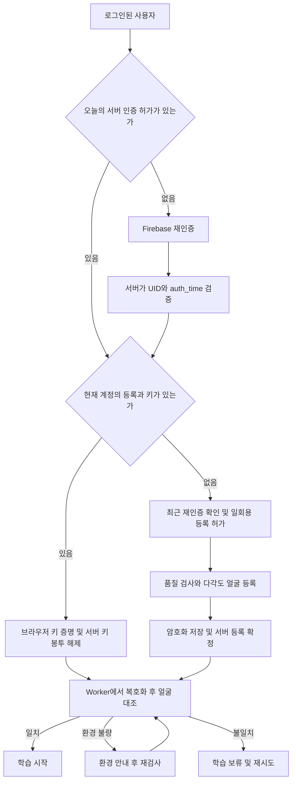

# 얼굴 등록·일일 재인증·브라우저 암호화 저장 계획서

작성일: 2026-10-26
상태: 구현 기준안. 2026-10-26 로컬 구현과 자동 검증을 진행했다. [구현·검증 및 운영 조건](face-enrollment-implementation.md)을 참고한다. 아래의 현재 코드 검토 내용은 설계 당시의 스냅샷이다.
대상: 현재 `study` 웹사이트와 Firebase Authentication, 기존 학습 API.

## 1. 결정할 동작

사용자는 매일 첫 학습 전에 Firebase로 계정을 다시 인증한다. 최초 등록이나 브라우저 데이터 삭제 이후에는 그 인증을 마친 다음 얼굴을 등록한다. 얼굴이 이미 등록되어 있으면 기존 얼굴을 불러와 대조하며, 매일 새 얼굴로 덮어쓰지 않는다.

얼굴 사진·영상은 저장하거나 서버에 전송하지 않는다. 비교에 필요한 얼굴 특징값만 브라우저의 IndexedDB에 암호화해 저장한다. 특징값의 암호화를 풀려면 해당 브라우저에 보관된 키와, 올바른 계정으로 인증한 뒤 서버에서 허용받는 키 해제 절차가 모두 필요하도록 한다.

등록 화면에는 원형 얼굴 가이드, 방향별 진행 표시, 품질 안내, 완료 애니메이션을 제공한다. 진행률은 실제로 확보한 유효 표본에 따라 변한다. Face ID와 비슷한 안내 경험을 목표로 하지만, 일반 RGB 웹캠을 Face ID의 깊이 센서·보안 하드웨어와 같은 수준이라고 표현하지 않는다.

기본 정책은 다음과 같다. 숫자는 제품 정책의 제안값이며 실제 성능 검증 결과에 따라 확정한다.

| 항목 | 기본 설계 |
|---|---|
| 일일 기준 | 서버가 계산한 `Asia/Seoul`의 날짜, 다음 날 00:00에 만료 |
| 일일 인증 | 그날 첫 학습 전에 기존 Firebase 로그인 제공자로 명시적 재인증 |
| 최초·재등록 | 최근 5분 이내 재인증 + 해당 브라우저의 일회용 등록 허가 |
| 얼굴 등록 유지 | 일일 인증과 독립적으로 유지. 실패·재시작·날짜 변경만으로 교체 금지 |
| 인증하지 않은 상태 | 얼굴 복호화와 학습 시간 인정 모두 차단 |
| 데이터 삭제 | 복구 없이 새 등록. 서버의 이전 등록 이력은 유지 |
| 지원 환경 | HTTPS의 일반 브라우저. 비공개 모드는 지속 저장을 보장하지 않음 |
| 얼굴 처리 | 전용 Worker에서 처리. 원본·특징값·키의 로그 및 분석 수집 금지 |
| 암호화 | 특징값 AES-256-GCM, 브라우저 키 AES-KW, 외부 키 봉투 Cloud KMS |
| 정식 지원 기준 | 실제 기기·환경·계정 분리·재시작·삭제·공격 테스트를 통과한 환경만 지원 |

Firebase 계정 재인증은 계정 접근 권한을 확인한다. 휴대폰 명의 확인이나 등록 얼굴과 실명 수강생의 일치를 자동으로 보장하지 않는다. 본인이 대리인에게 계정 인증을 도와주는 경우까지 막으려면 등록 시 운영자 확인 등 별도 정책이 필요하다. 본 계획은 이 한계를 숨기지 않는다.

## 2. 현재 코드에서 확인한 출발점

저장소의 작업 중 파일을 읽기만 했다. 배포된 서비스와의 일치 여부는 이번 검토 범위에 포함하지 않았다. Serena 프로젝트는 실제 경로로 활성화했으나 활성 언어 서버가 없어 심볼 조회가 실패했다. 이후 좁은 `rg` 검색과 관련 코드 범위로 확인했다.

| 위치 | 확인한 동작 | 설계에 반영할 변경 |
|---|---|---|
| `camera-identity.js:10` | 1024차원 특징값 3개로 등록. 표본 수집 중 일관성 기준 0.85, 대조는 표본과의 최대 유사도 0.65 이상 | 품질을 통과한 다각도 표본 등록과 별도 평가로 검증한 판정으로 교체 |
| `camera-identity.js:28` | `study-camera-identity` DB, `profiles` 저장소의 `current` 한 항목에 저장 | UID·브라우저 설치 ID·등록 세대별 저장 구조로 변경 |
| `camera-identity.js:42` | 저장된 `session`이 현재 값과 같을 때만 재사용. `{version, session, samples}`를 암호화 없이 저장 | 실행 세션과 등록 수명을 분리하고 평문 저장 폐기 |
| `camera.js:33`, `camera.js:217` | 무작위 `cameraController`와 실행 토큰을 합쳐 `identityKey` 전달 | 학습 제어 ID는 유지하되 얼굴 등록의 식별자로 사용하지 않음 |
| `camera-worker.js:15` | Worker에서 로컬 얼굴 판별기 생성 | 허가된 프로필의 잠금 해제 후 판별기 시작 |
| `auth.js:56` | Firebase SDK 13.0.0, `browserLocalPersistence`, 이메일/비밀번호와 Google 로그인 | 기존 로그인에 일일 재인증 계층 추가 |
| `auth.js:159` | Google 로그인에 `prompt: select_account` 사용 | 계정 선택 화면을 비밀번호·MFA 재검증과 동일시하지 않음 |
| `backend-config.js` | GitHub Pages 프런트엔드와 `https://api.study.junhyuk.site` API 구성 | Firebase Auth는 유지하고 기존 API에 일일 허가와 키 봉투 API 추가 |
| `functions/selfhost-server.js:153` | Firebase 토큰 검증, 사용자 비활성화·폐기 시점 확인에 최대 60초 캐시 | 키 해제·등록 같은 민감 요청은 최신 폐기 상태를 검증 |
| `functions/index.js:69`, `:96` | 학습 시작·카메라 동기화에 계정, 제어 ID, 순서, 임대 상태 검사 | 일일 인증과 활성 등록 세대 검증 추가 |
| `camera-focus.js`, `tests/camera-focus.test.mjs` | 본인 확인 유예 중 기존 추적을 이어가는 동작 존재 | 유예 UI와 인정 가능한 학습 시간을 구분 |

재시작 후 등록이 바뀌는 원인은 IndexedDB의 수명이 짧아서가 아니다. 코드가 실행별 식별자가 다른 저장 프로필을 재사용하지 않도록 되어 있다. 저장 수명과 프로필 선택 정책을 함께 바꿔야 한다.

## 3. 인증·등록·학습의 상태 모델

| 상태 | 의미 | 가능한 다음 동작 |
|---|---|---|
| `SIGNED_OUT` | Firebase 사용자 없음 | 로그인 |
| `DAILY_REAUTH_REQUIRED` | 오늘의 서버 허가 없음·만료 | 제공자별 재인증 |
| `PROFILE_MISSING` | 현재 UID의 암호문 또는 브라우저 키 없음 | 새 재인증 후 등록 허가 요청 |
| `PROFILE_LOCKED` | 암호문은 있으나 키가 잠겨 있음 | 일일 허가와 브라우저 키 증명으로 해제 |
| `ENROLLING` | 일회용 등록 허가 아래 촬영 중 | 품질 확인, 표본 수집, 취소 |
| `ENROLLMENT_COMMITTING` | 암호문 저장 및 서버 확정 중 | 성공 시 검증, 실패 시 안전하게 재시도 |
| `VERIFYING` | 기존 등록 얼굴과 현재 얼굴 대조 | 성공 시 학습 시작 |
| `VERIFIED` | 일일 허가와 얼굴 확인이 모두 유효 | 학습, 주기적 대조 |
| `QUALITY_HOLD` | 어두움·흐림·거리 등으로 판단 불가 | 환경 안내 후 재촬영 |
| `IDENTITY_MISMATCH` | 품질이 충분한데 대조 실패 | 재시도, 지원 요청. 자동 덮어쓰기 금지 |
| `RECOVERY_REQUIRED` | 손상, 키 손실, 모델 비호환, 등록 폐기 | 사유 안내 후 인증을 거친 새 등록 |
| `REVOKED` | 서버에서 등록 또는 계정 허가 폐기 | 사용 중단, 계정 복구 절차 |



화면이 닫히거나 프로세스가 종료되면 복호화한 특징값은 메모리와 함께 사라진다. 다시 접속할 때 암호화된 기존 등록을 불러온다. 같은 날의 유효한 인증 허가가 서버에 있으면 재인증 화면을 반복하지 않지만, 새 실행에서 얼굴 대조는 다시 한다.

## 4. Firebase 일일 재인증

### 4.1 제공자별 동작

| 계정 유형 | 사용자에게 요구할 동작 | 서버 판단 |
|---|---|---|
| 이메일/비밀번호 | 비밀번호를 다시 입력하고 `reauthenticateWithCredential` 실행 | 서명 검증된 토큰의 UID, 제공자, `auth_time` 확인 |
| Google | `reauthenticateWithPopup` 또는 지원되는 리디렉션 흐름 | 현재 UID가 유지되는지 확인. 다른 계정 선택은 등록 계정 변경으로 인정하지 않음 |
| MFA 설정 계정 | 재인증 중 Firebase MFA 챌린지 완료 | 확인된 2차 인증 상태와 정책 일치 여부 확인 |
| 익명·지원하지 않는 제공자 | 정식 계정 연결 또는 지원 안내 | 익명 계정으로 얼굴 등록 허가 발급 금지 |

인증 실패, 팝업 차단, 취소는 기존 등록을 삭제하지 않는다. 비밀번호·OTP는 앱 로그와 저장소에 남기지 않는다. 이메일 인증 여부를 매일 확인하는 것과 매일 재인증하는 것을 구분한다. `sendEmailVerification` 반복 호출로 일일 인증을 대체하지 않는다.

Google 제공자는 기존 제공자 세션을 재사용할 수 있다. `select_account`는 매번 비밀정보를 다시 입력했다는 증거가 아니다. 사용자 존재 확인 강도를 높이는 단계에서는 Firebase Authentication with Identity Platform의 TOTP MFA 도입을 검토한다. 해당 기능의 활성화·요금·사용자 복구 경로는 별도 도입 항목이며 이미 설정되었다고 가정하지 않는다. [Firebase 재인증](https://firebase.google.com/docs/auth/web/manage-users), [TOTP MFA](https://firebase.google.com/docs/auth/web/totp-mfa)

### 4.2 서버의 일일 허가 발급

1. 클라이언트가 일일 인증 챌린지를 요청한다. 서버는 UID, 목적, 브라우저 설치 ID, 서버 시각, 무작위 nonce를 묶어 5분짜리 챌린지를 발급한다.
2. 클라이언트가 Firebase 재인증을 완료하고 최신 ID 토큰을 제출한다. 단순 토큰 강제 갱신만으로 이 단계를 통과시키지 않는다.
3. 서버는 토큰 서명, issuer, audience/project, 만료, 사용자 비활성화, 폐기 상태를 검증한다. 요청 본문의 UID를 신뢰하지 않는다.
4. `auth_time`이 서버 기준 최근 5분 이내이고 오늘 날짜에 속하는지 확인한다. 챌린지가 요구한 재인증보다 과거인 값은 거절하되 초 단위 시간 표현의 오차만 제한적으로 허용한다. `iat`와 토큰 만료 갱신 시각으로 대체하지 않는다.
5. 기존 브라우저 등록은 장치 서명키의 소유 증명도 확인한다. 최초 등록은 별도의 등록 허가 흐름을 적용한다.
6. 서버가 오늘의 허가를 저장한다. 만료는 다음 날 서울 시각 00:00이고, UID·설치 ID·등록 세대·정책 버전에 결합한다.
7. 허가 ID가 유출되어도 그것만으로 사용하지 못하게 Firebase 인증과 브라우저 소유 증명을 함께 요구한다.

최근 인증 판단에 `auth_time`을 쓰는 방식은 Firebase의 세션 보안 예시를 따른다. 본 계획의 날짜별 허가는 서비스가 별도로 구현해야 하는 정책이다. Firebase가 자동으로 매일 인증을 요구하는 설정이라고 설명하지 않는다. [Firebase 최근 인증 확인](https://firebase.google.com/docs/auth/admin/manage-cookies)

### 4.3 시간 경계와 복구

- 자정이 되면 안내를 띄우고 학습 인정 구간을 자정까지로 종료한다. 새 인증 후 새 구간으로 재개한다. 클라이언트 시계·시간대를 바꿔 연장할 수 없다.
- 탭을 열어 둔 상태, 절전 복귀, Worker 재시작에서도 서버 만료를 다시 확인한다.
- 오프라인이나 API 장애 시 새 등록·새 잠금 해제·인정 시간 연장을 허용하지 않는다. 이미 서버가 확정한 학습 기록은 보존한다.
- 로그아웃·계정 변경 시 Worker와 메모리 키를 폐기한다. 일일 허가도 폐기 요청하며, 네트워크 실패 시 서버 만료가 최종 제한이 된다. Firebase ID 토큰은 단순 로그아웃만으로 이미 탈취된 토큰까지 즉시 무효화되지 않는다는 점을 구분한다.
- 비밀번호 재설정·계정 폐기·기기 등록 해제 시 서버의 모든 해당 허가와 활성 임대를 취소한다.
- 브라우저 데이터가 없어지면 같은 날이라도 새 등록을 위한 최근 재인증을 요구한다. 오늘 인증했다는 클라이언트 표시로 생략하지 않는다.

## 5. 얼굴 등록 화면과 애니메이션

### 5.1 화면 구성

전체 화면 또는 집중 모달을 사용한다. 상단에는 `계정 확인 → 촬영 준비 → 얼굴 등록 → 저장 완료` 단계를 표시하고, 중앙에는 원형/타원형 카메라 미리보기를 배치한다. 하단에는 현재 해야 할 행동 하나와 취소 버튼을 보여준다.

미리보기 외곽에 5개 방향 영역을 둔다. 각 영역은 대기·수집 중·완료 상태를 가진다. 정면, 왼쪽, 오른쪽, 약간 위, 약간 아래 순서로 안내하되, 좌우는 사용자가 보는 거울 화면 기준으로 일관되게 표시한다. 별도 무작위 동작 과제는 예측 가능한 방향 순서와 분리한다.

| 단계 | 화면 문구 예시 | 표시와 전환 기준 |
|---|---|---|
| 개인정보 안내 | `얼굴 사진은 저장하지 않아요. 얼굴 비교 정보는 이 브라우저에 암호화해 보관해요.` | 동의·보관·삭제 안내와 현재 계정 표시 |
| 카메라 준비 | `얼굴을 안내선 안에 맞춰 주세요` | 안내선과 거리 표시. 권한 거절 시 설정 안내 |
| 조명 안정화 | `조명이 맞춰질 때까지 잠시 기다려 주세요` | 1~2초를 초기 목표로 품질 수치 안정 여부 판단 |
| 정면 | `정면을 편하게 바라봐 주세요` | 유효 표본 4개가 확보될 때 해당 영역 완료 |
| 좌·우 | `고개를 조금만 왼쪽/오른쪽으로 돌려 주세요` | 각각 유효 표본 2개 |
| 상·하 | `턱을 조금만 올려/내려 주세요` | 각각 유효 표본 2개 |
| 재확인 | `정면을 다시 봐 주세요` | 등록에 쓰지 않은 새 프레임으로 일관성 확인 |
| 저장 | `얼굴 정보를 안전하게 저장하고 있어요` | 암호화, DB 저장, 서버 확정 전에는 완료 표시 금지 |
| 완료 | `얼굴 등록이 완료됐어요` | 짧은 원형 체크 전환 후 학습 시작 |

목표 촬영 시간은 좋은 환경에서 약 15~30초다. 고정 카운트다운으로 완료시키지 않는다. 45초 동안 진전이 없으면 원인을 설명하고 다시 시도하거나 취소할 수 있게 한다. 대기만으로 자동 승인하지 않는다.

### 5.2 애니메이션 규칙

- 원형 가이드는 CSS/SVG로 제작한다. 별도 생성 이미지나 영상 파일은 필요하지 않다.
- 진행률은 `유효 표본 수 / 필요한 표본 수`와 방향별 충족 상태로 계산한다. 얼굴 검출만으로 진행하지 않는다.
- 품질이 나빠지면 진행 표시를 멈추고 해당 문제 한 가지만 보여준다. 이미 통과한 표본은 유지하되 다른 사람이 들어왔다는 의심이 있으면 전체 후보를 폐기한다.
- 상태 전환은 약 150~250ms, 완료 표시는 약 400~600ms를 시안 목표로 한다. 추론 빈도와 화면 애니메이션 빈도를 분리한다.
- 빨강/초록만으로 성공·실패를 구분하지 않고 아이콘·문구를 함께 제공한다.
- `prefers-reduced-motion`이면 회전·확대 효과를 제거하고 단계와 정적 진행률을 보여준다.
- 스크린리더 안내는 단계 변경 때만 읽고, 프레임마다 알림을 반복하지 않는다. 키보드 취소와 포커스 복귀를 제공한다.
- 고개를 움직이기 어려운 사용자를 위해 운영자가 승인하는 별도 절차를 마련한다. 어려운 방향을 건너뛰고 같은 검증 수준이라고 표시하지 않는다.
- 취소하면 카메라 트랙, 이미지 버퍼, 텐서, 후보 특징값, 등록 티켓을 정리한다.

## 6. 외부 환경 영향을 줄이는 등록·대조

### 6.1 촬영 조건과 품질 게이트

가능하면 전면 카메라, 720p 이상, 적절한 프레임 속도를 요청하되 `ideal` 조건으로 시작한다. 실제 카메라 해상도와 프레임 속도를 읽고 처리 부하에 맞춘다. 지원하지 않는 노출·초점 제어를 강제하지 않는다.

| 품질 항목 | 판정 방식 | 사용자에게 안내할 내용 |
|---|---|---|
| 얼굴 수 | 정확히 1명일 때만 표본 수집 | `화면에 한 사람만 나오게 해 주세요` |
| 얼굴 크기·거리 | 얼굴 영역과 눈 사이 픽셀 수, 잘린 영역 확인 | `조금 가까이/멀리 이동해 주세요` |
| 밝기 | 얼굴 영역의 휘도 분포와 암부·포화 비율 | `얼굴 앞쪽을 조금 더 밝게 해 주세요` |
| 역광·그림자 | 얼굴 좌우와 배경 밝기 차이 | `창문을 등지지 않도록 위치를 바꿔 주세요` |
| 흔들림·초점 | 정규화된 얼굴 영역의 선명도와 연속 프레임 움직임 | `잠시 움직이지 말아 주세요` |
| 가림 | 눈·코 등 핵심 랜드마크의 가시성과 품질 | `얼굴을 가리는 물체를 치워 주세요` |
| 각도 | yaw/pitch/roll과 요청한 방향 영역 일치 | `고개를 조금만 돌려 주세요` |
| 반사 | 안경 부근 포화와 랜드마크 불안정 | `빛이 안경에 반사되지 않게 조정해 주세요` |

밝기·선명도의 수치 기준은 카메라 해상도와 모델에 의존하므로 코드 검토만으로 확정하지 않는다. 초기 실험 범위는 정면 yaw/pitch 약 ±8도, 좌우 yaw 약 12~22도, 상하 pitch 약 8~15도로 두고, 실제 추정 오차와 사용성을 측정해 조정한다. 큰 회전·극단적인 표정·과도한 밝기 보정은 사용하지 않는다.

밝기·초점 품질이 낮으면 `다른 사람`이 아니라 `판단 보류`로 처리한다. 환경 문제를 해결하기 위해 동일인 판정 임계값을 자동으로 낮추지 않는다. 조명·각도가 오거부에 영향을 준다는 근거는 [NIST 얼굴인식 평가](https://pages.nist.gov/frvt/html/frvt11.html)를 참고한다.

### 6.2 전처리와 표본 구성

1. 눈·코 랜드마크로 얼굴을 정렬한다. 회전·크기·위치를 일관되게 맞추고 모델이 요구하는 입력 크기·RGB 순서·정규화를 적용한다.
2. 현재 모델의 `224×224`, `global_pooling/Mean`, 1024차원 출력을 공식 모델 정의와 대조한다. 현재 코드가 실행된다는 이유만으로 입력 스케일이 최적이라고 가정하지 않는다.
3. 등록과 인증에 같은 전처리 버전을 사용한다. 밝기 보정·CLAHE 등의 추가 전처리는 원본 대비 오인식·오거부 평가를 통과할 때만 채택한다.
4. 5개 방향에서 총 12개 유효 표본을 목표로 수집한다. 같은 프레임을 여러 번 세지 않고 표본 사이 약 400ms 이상과 품질 안정 구간을 둔다.
5. 모든 후보 사이의 동일인 일관성을 검사한다. 여러 명 등장, 급격한 얼굴 교체, 일관성 붕괴 시 후보를 초기화한다. 등록 도중 다른 사람으로 바뀌면 처음부터 다시 해야 한다.
6. 표본을 L2 정규화하고 방향별 중복을 줄인다. 등록에 쓰지 않은 정면 프레임으로 마지막 대조를 수행한다.
7. float32 기준 12×1024×4 = 49,152바이트, 약 48KiB의 특징값과 소량의 버전·품질 메타데이터만 암호화한다. 최종 모델 차원 변경 시 다시 계산한다.

안경을 자주 착용하는 사용자는 평소 학습 상태로 등록한다. 안경 착용/미착용 보조 표본 추가는 기존 얼굴 확인과 최근 재인증을 모두 통과한 별도 변경 절차로 한정한다. 인증 실패 프레임을 등록 표본에 자동 추가하는 적응형 학습은 사용하지 않는다.

### 6.3 일상적인 얼굴 대조

- 단일 표본의 최대 점수만으로 통과시키는 현재 방식을 재평가한다. 우선 후보는 방향별 대표 표본을 활용한 상위 복수 점수의 집계이며, 집계 방식과 임계값을 함께 검증한다.
- 초기 사용자 경험 목표는 약 2~3초의 유효 프레임 중 5회 관측에서 4회 일치다. 이는 보안이 검증된 확정값이 아니며 조명·저사양 장치 평가 후 결정한다.
- 품질 불량 프레임은 실패 횟수와 구분한다. 통과 상태를 무제한 유지하는 근거로도 쓰지 않는다.
- 불일치 시 일정 시간 재확인하되 해당 구간은 미확정으로 보류한다. 복귀를 확인한 뒤에만 정책이 허용하는 구간을 인정하고, 실패하면 보류 구간을 버린다. 경고 표시를 늦추는 것과 학습 시간을 계속 인정하는 것을 분리한다.
- 카메라 재시작, 학습 재개, 장시간 화면 이탈 이후에는 기존 템플릿과 다시 대조한다.
- 모델·전처리 버전이 다르면 임의로 비교하지 않는다. 호환성 검증 또는 인증된 재등록으로 전환한다.

### 6.4 사진·영상 재생 대응

무작위 순서의 짧은 고개 움직임 등을 등록에 포함할 수 있으나, 그것만으로 검증된 생체 위조 탐지(PAD)라고 주장하지 않는다. 사진, 화면 재생, 가상 카메라, 영상 주입을 별도로 평가한다. 일반 웹 앱은 사용자가 조작한 브라우저의 입력과 실행 코드를 완전히 신뢰할 수 없다.

로컬 특징값 보호와 강한 원격 본인 증명은 다른 요구다. 브라우저가 보낸 `matched: true`나 장치 서명은 정상 얼굴 추론이 실행됐다는 증명이 아니다. 높은 수준의 부정 방지 보장이 필요하면 검증된 PAD와 신뢰할 수 있는 실행 환경에 대한 별도 설계가 필요하다. [NIST 생체인증 지침](https://pages.nist.gov/800-63-4/sp800-63b.html#sec-3-2-3)

## 7. 암호화 구조

### 7.1 보호 목표와 한계

목표는 ① 암호문 파일만 복사해도 열 수 없고, ② 다른 Firebase 계정으로 키 해제를 받을 수 없고, ③ 다른 사이트의 정상 스크립트에서 접근할 수 없고, ④ 서버 DB만 유출되어 얼굴 특징값이 노출되지 않도록 하는 것이다.

복호화와 추론이 실행되는 동안에는 특징값이 메모리에 존재한다. 동일 출처의 XSS, 악성 확장 프로그램, 브라우저/운영체제 장악, 정상 사용자가 의도적으로 정보를 추출하는 상황까지 웹 암호화가 막아 주지는 않는다. `extractable: false`도 API를 통한 키 내보내기를 제한하는 속성이며 하드웨어 보관이나 브라우저 프로필 복제 방지를 보장하지 않는다. 완전한 메모리 삭제 역시 JavaScript·GPU 환경에서 보증하지 않는다.

IndexedDB는 비밀 금고가 아니다. 같은 출처에서 실행되는 악성 스크립트는 그 출처의 저장소에 접근할 수 있다. 따라서 저장 암호화와 XSS·공급망 방어를 함께 적용해야 한다. [OWASP 브라우저 저장 보안](https://cheatsheetseries.owasp.org/cheatsheets/HTML5_Security_Cheat_Sheet.html)

### 7.2 사용할 키

| 키·값 | 생성·저장 위치 | 역할 |
|---|---|---|
| `DEK` | 등록 Worker에서 안전한 난수로 생성. AES-256-GCM | 특징값 암호화. 원시 키를 디스크·서버에 저장하지 않음 |
| `LWK` | 계정·브라우저 설치별 AES-256-KW CryptoKey. IndexedDB에 `extractable:false`로 저장 | DEK를 로컬 키로 감싸기/풀기 |
| `deviceSigningKey` | 별도의 ECDSA P-256 개인키. IndexedDB에 `extractable:false`; 공개키만 서버 등록 | 서버 nonce에 서명해 등록 브라우저의 키 소유 증명 |
| `serverKEK` | Cloud KMS에서 관리. 브라우저와 서버 DB에 원시 키 저장 금지 | 이미 LWK로 감싼 DEK를 한 번 더 감싸는 외부 봉투 암호화 |
| IV | AES-GCM 암호화마다 새로운 96비트 난수 | 같은 키에서 IV 재사용 금지 |
| AAD | 정규화된 바인딩 메타데이터 | 계정·사이트·프로필·버전 바꿔치기 탐지 |

Firebase API key, UID, 이메일, ID 토큰, 브라우저 설치 ID, 날짜는 암호화 비밀키로 사용하지 않는다. 비밀번호를 앱에서 별도 암호화 키로 재사용하지 않는다. 직접 만든 암호 알고리즘이나 문자열 난독화도 사용하지 않는다.

### 7.3 암호문과 두 겹의 키 봉투

다음은 구현 코드가 아닌 데이터 흐름 표기다.

```text
특징값 -- AES-256-GCM(DEK, 새 IV, AAD) --> C
DEK    -- AES-256-KW(LWK) -------------> W_local
W_local -- Cloud KMS(serverKEK, AAD) ---> W_server

브라우저 디스크: C + IV + AAD 메타데이터 + W_server + LWK + 서명 개인키
서버: 등록 메타데이터 + 공개키 + W_server 해시 + 허가·폐기 상태
KMS: serverKEK
```

서버로 전송하는 것은 `W_local`과 필요한 메타데이터이며 얼굴 특징값·사진·DEK·LWK는 전송하지 않는다. KMS가 외부 봉투를 풀어도 결과는 LWK로 감싼 키이므로 서버가 단독으로 얼굴을 복호화할 수 있도록 설계하지 않는다. 다만 서버가 프런트엔드까지 장악해 악성 코드를 배포하는 위협은 별개다.

`W_local`은 인증된 HTTPS 요청·응답 중에만 취급하고 브라우저 영구 저장소·HTTP 캐시·서버 로그·분석 도구에 저장하지 않는다. 정상 클라이언트는 사용 후 참조를 해제한다. 이미 `W_local` 또는 DEK를 빼낸 공격자에게 서버의 일일 잠금 정책을 소급 적용할 수는 없다.

AAD는 UTF-8의 고정된 필드 순서·형식으로 직렬화한다. 필드는 `projectId`, 정식 `appOrigin`, `uid`, `installationId`, `profileId`, `generation`, `modelVersion`, `preprocessVersion`, `schemaVersion`, `purpose=face-profile`이다. 이메일·닉네임처럼 바뀌는 값은 제외한다. 서버는 인증 토큰과 서버 등록 레코드로 AAD를 재구성하며, 요청자가 보낸 UID·origin을 그대로 믿지 않는다.

AAD는 암호화를 제공하는 비밀값이 아니다. 값 변경을 탐지하는 바인딩이다. 다른 브라우저에서 같은 문자열을 만들었다는 이유만으로 키를 얻을 수 없도록 UID 검증·브라우저 키 증명·서버 등록 상태를 함께 검사한다. [Web Crypto 키 래핑](https://developer.mozilla.org/en-US/docs/Web/API/SubtleCrypto/wrapKey), [KMS AAD](https://docs.cloud.google.com/kms/docs/additional-authenticated-data)

### 7.4 최초 등록 시 저장 순서

1. 서버가 최근 재인증과 계정 정책을 확인하고 새 `profileId`, `generation`, 일회용 티켓을 발급한다.
2. 브라우저는 계정별 LWK와 서명키를 생성한다. 서버는 공개키 및 nonce 서명을 등록 요청에 묶어 확인한다. 재등록이면 기존 등록을 바로 지우지 않고 후보 세대를 만든다.
3. Worker가 품질 검사·후보 표본·마지막 대조를 완료한다.
4. Worker가 DEK를 생성해 특징값과 민감 메타데이터를 AES-GCM으로 암호화한다. GCM 태그 길이는 128비트로 한다.
5. Web Crypto `wrapKey`를 사용하기 위해 최초 DEK는 잠깐 `extractable:true`로 생성한다. LWK로 감싼 뒤 사용을 끝내고 참조를 해제한다. 이후 인증용 DEK는 `unwrapKey(..., extractable:false)`로 가져온다. 처음부터 내보내기 불가능한 DEK를 `wrapKey`할 수 있다고 가정하지 않는다.
6. 인증된 등록 API에 `W_local`을 보내 KMS 외부 봉투 `W_server`를 받는다. 서버는 요청 크기, 티켓, nonce, UID, 브라우저 공개키, 버전을 검증한다. 일반적인 임의 암복호화 API로 노출하지 않는다.
7. IndexedDB 트랜잭션으로 암호문·키·봉투를 `pending` 상태로 기록한다. 요청 성공 콜백이 아니라 트랜잭션 완료를 확인한다.
8. 서버에 등록 확정을 요청한다. 서버는 티켓을 일회 소비하고 활성 세대를 원자적으로 갱신한다. 서버에는 봉투 해시와 등록 상태를 남긴다. 동시 확정 충돌은 하나만 성공한다.
9. 클라이언트가 서버 확정을 확인한 뒤 로컬 상태를 `active`로 바꾼다. 응답 유실 시 상태 조회로 복구한다. 무조건 재등록하지 않는다.
10. 새로 저장한 봉투를 인증된 해제 경로로 다시 열어 특징값 복호화와 얼굴 대조를 확인한 후 완료 애니메이션을 표시한다.

서버 확정 전 실패하면 기존 활성 등록을 유지한다. 이전 등록이 없는 최초 등록은 학습을 열지 않는다. 중간 후보와 만료 티켓은 정리하며 동일 요청의 네트워크 재시도는 idempotency key로 같은 결과를 반환한다.

### 7.5 다시 접속할 때 잠금 해제

1. 현재 Firebase UID를 확인하고 해당 UID의 프로필만 선택한다. 다른 계정의 `current` 값을 재사용하지 않는다.
2. 오늘의 서버 허가가 없으면 재인증한다. 암호문이 있어도 이 과정을 생략하지 않는다.
3. 서버가 일회용 unlock nonce를 발급한다. nonce는 60초 만료, UID·프로필·세대·요청 목적·봉투 해시에 결합한다.
4. 브라우저가 별도 서명키로 정해진 메시지에 서명한다. 서버는 공개키, 최신 등록 상태, 일일 허가, 토큰 폐기 여부를 확인한다.
5. 서버는 현재 레코드의 AAD로 KMS에 외부 봉투 해제를 요청한다. 해시가 등록된 봉투와 다르면 거절한다.
6. `W_local`을 `Cache-Control: no-store` 응답으로 반환한다. 서비스 워커·프록시·오류 수집기도 이 경로의 본문을 저장하지 않는다.
7. Worker가 LWK로 DEK를 내보내기 불가능한 CryptoKey로 복원하고 C를 복호화한다. GCM 태그·스키마·길이·유한 수·모델 버전을 검증한다.
8. 얼굴 대조를 통과해야 학습을 시작한다. 일일 허가나 키 해제 성공을 얼굴 일치로 해석하지 않는다.

로그아웃, 계정 변경, 학습 종료, 자정 만료, 브라우저의 장시간 비활성화 시 Worker를 종료하고 DEK·평문 템플릿의 참조를 버린다. 장시간 비활성화의 초기 기준은 5분이다. 재개 시 서버 해제와 얼굴 대조를 다시 한다. 버퍼 초기화와 텐서 dispose는 수행하되 물리적 메모리 완전 삭제를 보장한다고 표현하지 않는다.

### 7.6 서버 키 운영

권장안은 Cloud KMS를 기존 Windows API에서 호출하는 방식이다. 별도 얼굴 저장 서버를 만드는 것이 아니다. KMS 활성화·과금·서비스 계정 권한과 Windows 환경의 안전한 워크로드 자격 증명을 구현 단계에서 확정한다. 서비스 계정 키를 브라우저나 저장소에 넣지 않는다.

KMS 리소스에만 최소 encrypt/decrypt 권한을 부여하고 관리자 권한을 분리한다. 키 버전 ID를 봉투와 연결한다. 키 교체는 외부 봉투 재암호화만으로 처리할 수 있게 설계하고, 이전 버전 폐기는 사용 중인 등록의 전환을 확인한 후 진행한다. 서버 DB 복원으로 과거 폐기 세대가 살아나지 않도록 감사·폐기 상태 복구 기준을 마련한다.

KMS 장애 때 암호화를 건너뛰거나 평문 키를 디스크에 임시 저장하는 우회는 두지 않는다. KMS를 사용하지 않는 별도 대안은 운영체제 키 보호·백업·회전 설계를 포함한 재검토가 필요하며, 소스코드나 `.env`의 고정 키 하나로 조용히 대체하지 않는다.

## 8. 저장 형식·보관·삭제

### 8.1 브라우저 IndexedDB

새 DB 예시 이름은 `study-face-v2`이다. 아래 필드 이름은 계약 초안이며 실제 코드가 아니다.

| 저장소 | 키 | 내용 |
|---|---|---|
| `profiles` | UID + 설치 ID + 프로필 ID | 스키마·모델 버전, 세대, IV, GCM 암호문/태그, KMS 외부 봉투, 생성 시각, pending/active 상태 |
| `keys` | UID + 설치 ID + 키 용도 | LWK와 서명 개인키 CryptoKey |
| `settings` | UID + 설치 ID | 동의 버전, 영구 저장 승인 여부, 사용자 표시용 등록 정보 |

얼굴 특징값과 세부 품질 값은 암호문 안에 넣는다. 암호화 바인딩에 필요한 최소 헤더만 평문으로 둔다. 원본 사진, 캔버스 이미지, 프레임 썸네일, 실패 얼굴, 비밀번호, DEK, `W_local`을 저장하지 않는다.

브라우저에 저장된 키와 프로필은 정상 API를 통한 동일 출처 경계를 따른다. 파일 시스템 관리자 권한이나 브라우저 프로필 전체 복제에 대한 보호를 별도로 보장하지 않는다. 공유 PC에서는 사용 후 등록 삭제 옵션과 계정 전환 시 메모리 잠금을 제공한다.

### 8.2 서버 메타데이터

기존 저장소 추상화 아래 UID 소유 레코드로 관리한다. Firestore 직접 클라이언트 쓰기나 셀프호스트의 범용 읽기 API로 키 관리 컬렉션을 노출하지 않는다.

- 등록 레코드: UID, 설치 ID, 프로필 ID, 세대, 공개 서명키, 허용 origin, 모델/정책 버전, 봉투 해시, 활성/폐기 상태, 생성·폐기 시각.
- 일일 허가: UID, 설치 ID, 활성 세대, 서버 날짜, 확인한 `auth_time`, 인증 강도, 만료 시각, 폐기 상태.
- 짧은 수명 데이터: 등록/해제 nonce, 티켓 목적·만료·소비 상태, idempotency 결과.
- 감사 기록: 등록/재등록/폐기 이벤트, 결과 코드와 서버 시각. 얼굴·키·인증 토큰·응답 본문 금지.

활성 등록은 사용자가 삭제할 때까지 유지한다. 제안 보관 기간은 만료된 티켓·일일 허가 24시간 이내 정리, 등록 변경 감사 기록 90일이다. 유효성 검사는 즉시 수행하고 백그라운드 TTL 삭제 완료를 기다리지 않는다. 계정 탈퇴 시 등록·허가를 즉시 폐기하고, 백업 보관 범위와 실제 삭제 일정을 안내한다.

### 8.3 저장 수명과 복구 정책

IndexedDB는 고정 만료가 없지만 사용자 삭제, 브라우저 정리, 저장 공간 부족, 프로필 변경 등에 영향을 받는다. `navigator.storage.persist()`를 요청하고 승인 여부를 기록하되 거절 시 정상적으로 설명한다. 승인은 사용자의 삭제를 막지 않는다. [브라우저 저장 정책](https://developer.mozilla.org/en-US/docs/Web/API/Storage_API/Storage_quotas_and_eviction_criteria)

Safari의 사이트 비상호작용에 따른 저장 정리와 홈 화면 웹 앱 예외를 실제 지원 버전에서 시험한다. “7일이 지나면 항상 삭제”나 “영구 저장이면 절대 삭제되지 않음”으로 안내하지 않는다. 비공개 모드를 억지로 탐지하기보다 실제 쓰기·읽기·CryptoKey 저장 지원 여부와 다음 접속의 존재 여부로 처리한다. [WebKit 저장 정책](https://webkit.org/tracking-prevention/)

암호문만 남거나 키만 남으면 손상 상태로 보고 자동 교체하지 않는다. 재인증 후 이전 세대 폐기와 새 등록을 진행한다. 다른 기기·다른 브라우저·프로필에는 얼굴 데이터를 자동 동기화하지 않는다. 새 등록 시 이전 등록을 교체한다는 내용을 명시하고 기본적으로 계정당 활성 브라우저 등록 1개를 유지한다. 여러 기기 허용은 후속 정책으로 분리한다.

재등록 제한의 제안값은 계정당 24시간 내 3회까지이며, 초과하면 운영자 확인 경로를 제공한다. 브라우저가 정상적으로 데이터를 지운 사용자도 복구할 수 있어야 한다. 횟수와 폐기 기록은 서버에 보관하므로 브라우저 삭제로 초기화되지 않는다. 재등록 자체는 기존 얼굴의 본인 일치를 증명하지 못하므로 이력 관리와 실명 확인 정책의 한계를 함께 안내한다.

## 9. API와 학습 시간 연계

API 이름은 기존 callable 추상화에 맞춘 후보이며 새 구현은 이 문서에 포함하지 않는다.

| API | 전제 조건 | 결과 및 서버의 책임 |
|---|---|---|
| `getFaceEnrollmentStatus` | Firebase 사용자 | 해당 UID의 최소 등록 상태. 다른 사용자 정보 반환 금지 |
| `beginDailyFaceAuth` | Firebase 사용자 | 일회용 일일 인증 챌린지 발급 |
| `completeDailyFaceAuth` | 최근 재인증, 챌린지, 기존 기기 증명 | 서버 날짜의 일일 허가 발급 |
| `beginFaceEnrollment` | 최근 5분 인증, 재등록 제한 | 5분 만료 등록 티켓, 새 프로필 ID/세대, 공개키 등록 절차 |
| `sealFaceKeyEnvelope` | 유효 등록 티켓, 키 소유 증명 | LWK로 감싼 키의 KMS 외부 봉투 생성. 최대 요청 크기 제한 |
| `commitFaceEnrollment` | 같은 티켓, 로컬 저장 완료, idempotency key | 봉투 해시·공개키·세대 확정. 이전 세대와 허가 폐기, 새 세대 허가 결합 |
| `beginFaceUnlock` | 오늘 허가, 활성 프로필 | 60초짜리 서명 챌린지 |
| `unlockFaceKeyEnvelope` | Firebase 검증, 오늘 허가, nonce 서명 | 등록된 봉투만 해제. nonce 일회 소비, 응답 캐시 금지 |
| `revokeFaceEnrollment` | 최근 재인증 또는 승인된 계정 보안 절차 | 등록·일일 허가·학습 임대 폐기 |

등록 중 최초 브라우저에는 기존 서명키가 없으므로 `beginFaceEnrollment`에서 새 공개키를 증명하고 등록 티켓에 고정한다. 이후 다른 공개키로 바꾸는 요청은 거절한다. 모든 세대 교체는 서버 트랜잭션 또는 동등한 원자 연산으로 수행한다. 새 세대로 허가를 옮길 때도 원래의 일일 만료를 늘리지 않는다.

`startStudySession`과 `syncStudyCamera`는 카메라 학습의 활성 등록 세대와 일일 허가를 확인한다. 기존 sequence·controllerId·이벤트 중복 방지·임대 규칙은 함께 유지한다. 허가 만료 이후 구간은 서버가 인정하지 않도록 checkpoint 계산에서 만료 시각으로 잘라야 한다. 만료 후 동기화 한 번으로 이전 추적 구간이 계속 늘어나지 않게 한다.

`prepareWordStudy`, `startWordStudy`, `syncWordStudy`의 전환 경로도 검토한다. 얼굴 확인이 필요한 학습 정책에서 단어앱 전환이나 비카메라 세션 생성으로 같은 보상을 우회해서 받지 못하도록 인정 기록의 유형과 정책을 명시한다. 일반 수동 타이머는 별도 기록으로 제공할 수 있지만 본인 확인을 거친 학습으로 표시하지 않는다.

일일 허가는 다음 자정까지 유효하되, 실제 학습 인정에는 최대 60초의 짧은 권한 임대를 추가한다. 기존 동기화 요청에서 서버가 등록 폐기·일일 만료를 확인하며 갱신하고, 임대 만료를 넘어서는 시간은 인정하지 않는다. 기존 카메라 임대가 더 짧으면 더 짧은 값을 따른다. KMS를 프레임마다 호출하지 않고 프로필 잠금 해제·새 등록·키 회전 시에만 사용한다. 서버 장애와 계정 폐기 시 이미 복호화된 메모리를 원격으로 지울 수는 없지만 새 학습 시간 인정은 제한할 수 있다.

여러 탭에는 계정 변경·등록 세대 변경·로그아웃 이벤트를 전파해 기존 Worker를 잠근다. 탭 간 알림은 사용자 경험 개선용이며 권한의 근거는 서버 상태다. 서버의 활성 세대와 맞지 않는 탭은 다시 조회하고 임의로 이전 세대를 활성화하지 않는다.

서버가 확인할 수 있는 것은 계정 재인증·등록 상태·시간·키 증명이다. 얼굴 비교의 진위를 원격으로 입증하는 것은 아니다. 이 API 추가만으로 조작된 클라이언트의 학습 보고를 완전히 차단했다고 주장하지 않는다.

## 10. 사이트·스크립트·운영 보안

정식 얼굴 등록 origin은 `https://study.junhyuk.site` 하나로 고정하는 안을 권장한다. `word.junhyuk.site`와 GitHub Pages 대체 주소에 얼굴 저장소·키를 공유하지 않는다. 도메인 변경은 새 등록 또는 별도로 승인된 이전 절차가 필요하다.

키 API는 HTTPS, 토큰 검증, UID 권한 검사, 장치 서명, 일회용 nonce, 일일 허가를 필수로 한다. CORS allowlist와 Origin 검사는 추가 방어이며 브라우저 외부 클라이언트를 암호학적으로 식별하는 수단이 아니다. 요청자의 임의 Origin 헤더로 인증을 대체하지 않는다.

- CSP를 점검하고 스크립트 허용 출처를 최소화한다. 가능한 런타임과 모델 파일은 버전 고정·자체 호스팅·무결성 검증을 적용한다.
- 현재 jsDelivr에서 로드하는 얼굴 모델·MediaPipe와 Firebase SDK의 배포 경로를 목록화한다. 넓은 CDN 허용 규칙 하나로 끝내지 않는다.
- 외부 HTML을 그대로 삽입하지 않고 위험한 DOM 삽입 지점을 검사한다. 지원 환경에서는 Trusted Types를 검토한다.
- 등록·인증 화면의 세션 리플레이, DOM 스냅샷, 화면 녹화형 분석 도구를 끈다. 오류 객체·네트워크 본문 수집에서도 키와 생체정보를 제거한다.
- API는 민감 본문 로그를 끄고 키별 접근·실패 코드만 감사한다. UID별 속도 제한은 브라우저 설치 ID 변경으로 초기화하지 않는다.
- HTTP 응답 보안 헤더를 설정할 수 있는 배포 구성을 확인한다. GitHub Pages에서 필요한 헤더를 직접 설정하기 어려우면 지원하는 프록시/호스팅 구성을 도입 항목에 포함한다. HTML meta CSP만으로 `frame-ancestors` 등 모든 헤더 정책을 대체할 수 있다고 가정하지 않는다. [MDN frame-ancestors](https://developer.mozilla.org/en-US/docs/Web/HTTP/Reference/Headers/Content-Security-Policy/frame-ancestors)
- 서비스 워커가 인증·키 해제 응답을 캐시하지 않도록 명시적으로 제외한다. 새 버전과 이전 Worker가 섞이는 경우 스키마·정책 불일치를 안전하게 처리한다.
- App Check는 도입 시 자동화 남용을 줄이는 추가 계층으로만 평가한다. Firebase Auth나 얼굴 일치 증명을 대체하지 않는다. [Firebase App Check](https://firebase.google.com/docs/app-check)

## 11. 기존 데이터 이전과 장애 처리

현재 `study-camera-identity/profiles/current`의 평문 특징값은 새 암호화 저장소로 조용히 복사하지 않는다. 계정 결합과 등록 당시 본인 확인이 없기 때문이다.

사용자에게 새 등록이 필요함을 안내하고, 새로운 정책에 동의한 뒤 일일 재인증과 새 얼굴 등록을 진행한다. 기존 평문 프로필의 정리도 이 전환 과정에 포함한다. 다른 탭이 예전 버전으로 평문을 다시 저장하지 못하도록 버전 불일치 경고와 최소 지원 버전을 운영한다. 파일 삭제가 SSD·백업의 과거 복사본까지 즉시 완전 삭제한다는 보장은 하지 않는다.

| 상황 | 처리 |
|---|---|
| 카메라 권한 거절 | 설정 안내. 등록·학습 자동 통과 금지 |
| 인증 취소·실패 | 기존 암호문 유지, 잠금 상태 유지 |
| 여러 사람 등장 | 수집 중지, 교체 의심 시 후보 초기화 |
| 저장 공간 부족·DB 차단 | 저장 실패 안내. 완료 표시·학습 시작 금지 |
| CryptoKey 저장 미지원 | 미지원 환경 안내. 평문 키 저장으로 강등 금지 |
| KMS/API 장애 | 잠금 상태 유지, 재시도. 암호화 우회 금지 |
| 서버 확정 후 응답 유실 | idempotency와 상태 조회로 동일 등록 복구 |
| 암호문·AAD·태그 손상 | 복호화 실패, 인증된 복구 절차 |
| 날짜 변경·계정 폐기 | 허가 만료 시각으로 시간 인정 중단, 메모리 잠금 |
| 두 탭 동시 등록 | 한 세대만 확정. 다른 탭은 상태 갱신 |
| 다른 계정 로그인 | 이전 Worker 종료 후 새 UID의 저장소만 선택 |
| 브라우저 데이터 삭제 | 서버 이력을 유지한 채 새 인증·등록 |
| 모델 업데이트 | 호환성 검사. 필요 시 재인증 후 명시적 재등록 |

## 12. 변경할 파일과 구현 순서

아래는 향후 작업 범위이며 이번 작업에서는 생성하거나 수정하지 않는다.

| 파일·모듈 | 맡길 책임 |
|---|---|
| `auth.js` 또는 새 `auth-reauth.js` | 제공자별 재인증, UID 변경 방어, MFA 연결 |
| 새 `face-enrollment.js` | 등록 상태 머신, 품질 안내, 취소·재시도·접근성 |
| 새 `face-profile-store.js` | IndexedDB 스키마, 계정 분리, pending/active 트랜잭션 |
| 새 `face-profile-crypto.js` | DEK·LWK·AAD·암호문 검증과 키 수명 관리 |
| 새 `face-auth-client.js` | 일일 허가·등록·키 해제 API 계약 |
| `camera-identity.js` | 순수 특징 추출·대조. 무허가 자동 등록과 평문 저장 제거 |
| `camera-worker.js`, `camera.js` | 인증된 프로필 전달, Worker 수명, 실행 ID와 등록 ID 분리 |
| `camera-focus.js` | 품질 보류·불일치와 학습 인정 유예 분리 |
| `study.html`, `styles.css` | 원형 가이드·방향 진행·오류·완료 상태 |
| 새 `functions/face-auth-service.js` | 서버 날짜, auth_time, 티켓, UID, 활성 세대, 감사·제한 |
| 새 `functions/face-key-service.js` | KMS 외부 봉투 생성·해제, 요청 검증, 로그 제외 |
| `functions/index.js`, `functions/selfhost-server.js` | API 연결, 최근 폐기 검증, 학습 허가 검사 |
| `functions/platform-store.js`, `firestore.rules` | 서버 전용 레코드 접근과 저장소별 동등한 계약 |
| 학습 세션·단어 연동 모듈 | 날짜 만료·인증 보류의 시간 계산과 전환 우회 방지 |
| 기존/신규 테스트 | 아래 수용 기준 검증 |

구현 단계는 다음 순서로 나눈다.

1. **계약 확정:** 매일 인증의 의미, 정식 origin, 단일 기기 정책, 인증 강도, 재등록 지원 경로를 확정한다.
2. **기술 검증:** 지원 브라우저의 CryptoKey 영속 저장·AES-KW/GCM·KMS 왕복·Worker 구조 복제를 검증한다. 미지원 환경에서 보안을 낮추지 않는다.
3. **얼굴 품질 실험:** 현재 모델 입력 계약과 점수 분포를 확인하고 다각도 등록·환경 품질·인증 임계값을 평가한다.
4. **인증·암호화 구현:** 서버 권한과 일회용 티켓, 원자적 등록, 키 봉투 해제, 계정 분리를 먼저 완성한다.
5. **화면 구현:** 품질 상태와 연결된 실제 애니메이션, 모바일·접근성·취소·오류를 구현한다.
6. **학습 연동:** 일일 만료, 보류 시간, 재개, 단어앱 전환과 기존 동기화 계약을 연결한다.
7. **보안·사용성 검증:** 실제 브라우저 테스트와 공격 시나리오를 통과한 뒤 제한된 사용자로 시범 운영한다.
8. **전환:** 기존 평문 등록 정리와 새 등록 안내를 배포한다. 문제가 생겨도 평문/무인증 자동 등록으로 롤백하지 않는다. 기능을 일시 중단하거나 수동 기록으로 전환한다.

## 13. 검증과 수용 기준

이번에는 설계 문서만 작성했으므로 테스트·브라우저 실행·실사용 정확도 검증을 수행하지 않았다. 아래는 구현 완료 후 통과해야 할 기준이다.

### 13.1 인증과 암호화

| 검사 | 통과 조건 |
|---|---|
| 토큰 갱신만 수행 | `auth_time`이 오래되면 일일 허가 거절 |
| 자정·시간대 조작 | 서버 기준으로 만료되고 추가 시간 인정 불가 |
| A 계정 → B 계정 | A 프로필의 잠금 해제·학습 허가 불가 |
| 다른 origin·설치·세대 | 바인딩 불일치 또는 키 부재로 실패 |
| nonce·티켓 재사용 | 두 번째 요청 거절. idempotent 재시도만 같은 결과 |
| 암호문 한 바이트·IV·AAD 변경 | 인증 태그 또는 봉투 검증 실패 |
| 암호문만 복사 | DEK와 LWK 없이 복호화 불가 |
| 브라우저 키만 보유 | 일일 인증 및 서버 봉투 해제 없이 정상 앱에서 복호화 불가 |
| 서버 DB만 확보 | 얼굴 특징값·DEK·LWK가 없고 단독 복호화 불가 |
| 네트워크·분석·오류 로그 | 원본 이미지, 평문 특징값, DEK/LWK, 토큰, W_local 잔존 없음 |
| 저장 취소·크래시·응답 유실 | 미완료 등록이 활성화되지 않고 기존 세대가 잘못 사라지지 않음 |
| 로그아웃·계정 변경 | Worker 종료, 이전 UID 데이터가 화면과 다음 추론에 남지 않음 |
| 사용자 폐기 | 새 키 해제 즉시 거절. 학습 인정은 설정한 짧은 임대 만료 내 종료 |

키를 이미 정상적으로 해제한 공격자, 전체 브라우저 프로필 탈취, XSS가 키 사용을 대신 수행하는 경우를 별도 잔여 위험으로 보고한다. `extractable:false`만 보고 해당 검사를 통과 처리하지 않는다.

### 13.2 얼굴 성능과 환경

실제 지원 카메라·저사양 PC·모바일에서 밝은 실내, 어두운 실내, 역광, 좌우 그림자, 안경, 거리 변화, 다른 날의 재접속을 평가한다. 본인 표본과 다른 사람의 표본을 분리하고, 임계값 조정에 쓴 사용자·촬영 세션을 최종 평가 데이터에 재사용하지 않는다.

측정 항목은 등록 완료율·소요 시간, 품질 보류율, 동일인 오거부율, 다른 사람 오수락률, 최초 인증 지연, 장시간 사용 시 오경고 횟수다. 연속 프레임을 독립 실험처럼 세어 표본 수를 부풀리지 않는다.

초기 제품 목표는 지원 환경에서 등록 30초 이내 완료율 95% 이상, 동일인 재시도 후 실패율 5% 이하, 다른 사람 오수락률의 95% 신뢰상한 0.1% 이하로 제안한다. 이는 현재 성능 수치도 인증 표준 충족 선언도 아니다. 평가 규모가 부족해 신뢰상한을 입증하지 못하면 수치를 낮게 측정했더라도 달성으로 보고하지 않는다. 얼굴 위조 공격 성공률은 일반 오수락률과 별도로 측정한다.

소규모 시범에서는 최소 30~50명의 서로 다른 참여자와 여러 날·카메라 조건으로 문제를 찾는다. 정식 오수락 목표 입증에는 그보다 큰 적절한 독립 표본과 통계 검토가 필요하다. 충분한 성능을 확보하지 못하면 임계값을 임의로 낮춰 출시하지 않고 지원 환경·모델·인증 강도를 재검토한다.

평가용 생체정보는 실제 운영 데이터와 분리하고 참여 동의·접근 제한·삭제 일정을 마련한다. 실제 사용자의 얼굴 자료를 자동 수집해 성능 데이터셋으로 전용하지 않는다.

### 13.3 브라우저·화면·기존 기능

- Windows Chrome/Edge, Firefox, macOS Safari, iOS Safari, Android Chrome의 실제 지원 버전에서 재시작 후 CryptoKey와 프로필 복원을 시험한다.
- 새로고침, 탭 닫기, 브라우저 종료, PC 재부팅, 사이트 데이터 삭제, 비공개 세션 종료, 저장 공간 오류를 각각 시험한다.
- Safari 비상호작용 정리는 장기간 실기기 시험으로 확인하고 단순 시계 변경만으로 검증했다고 하지 않는다.
- 등록 애니메이션이 품질·표본 상태와 일치하는지 확인한다. 여러 얼굴·역광·저프레임 상황에서 진행이 멈춰야 한다.
- 키보드·스크린리더·동작 줄이기·세로 모바일 화면과 카메라 권한 거절 경로를 확인한다.
- 기존 카메라 Worker 복구, 집중 시간, 방 순위, 단어앱 전환, 중복 이벤트·sequence, 세션 정리 테스트를 필요한 범위에서 실행한다.
- 에뮬레이터 테스트와 실제 Firebase 제공자 재인증·MFA 테스트를 구분한다. 에뮬레이터 통과만으로 실제 인증 UX를 검증했다고 하지 않는다.

## 14. 구현 전에 확정할 사항

1. **매일 인증 강도:** 현재 이메일/Google 제공자의 재인증을 기본으로 할지, 등록·재등록 및 일일 인증에 TOTP까지 요구할지. 후자는 Identity Platform 도입과 사용자 복구 설계가 필요하다.
2. **등록 얼굴의 실명 확인:** 계정 소유 확인만으로 운영할지, 대리 등록을 막기 위해 최초·재등록에 운영자 확인을 둘지.
3. **키 관리 비용과 배포:** 기존 Windows API에서 Cloud KMS를 안전하게 호출할 자격 증명·권한·운영 담당자, 프런트엔드 보안 헤더 제공 방식.
4. **지원 정책:** 계정당 활성 브라우저 1개, 24시간 내 재등록 3회, 90일 감사 기록이라는 제안값의 채택 여부.
5. **성능 기준:** 실제 모델·카메라 평가로 지원 환경과 오수락·오거부 목표를 충족할 수 있는지.

이 항목들은 구현 시 확정할 제품 결정이다. 이번 계획서 작성이나 기술 검토를 중단하기 위한 승인 요청은 아니다.

## 15. 문서 검토 결과

현재 코드의 등록 수명, 평문 저장, Firebase 로그인, 서버 토큰 검증, 학습 시간 동기화 경로를 확인해 계획에 연결했다. Firebase 재인증·`auth_time`, Web Crypto의 키 래핑 제약, KMS의 AAD, 브라우저 저장 정책은 공식 문서로 확인했다.

실제 Firebase 프로젝트의 MFA 설정·KMS 권한·배포 보안 헤더·실기기 인식 정확도는 확인하지 않았다. 해당 부분은 구현 전 검증 항목으로 남긴다. 기존 애플리케이션 코드와 배포 설정은 변경하지 않았다.
