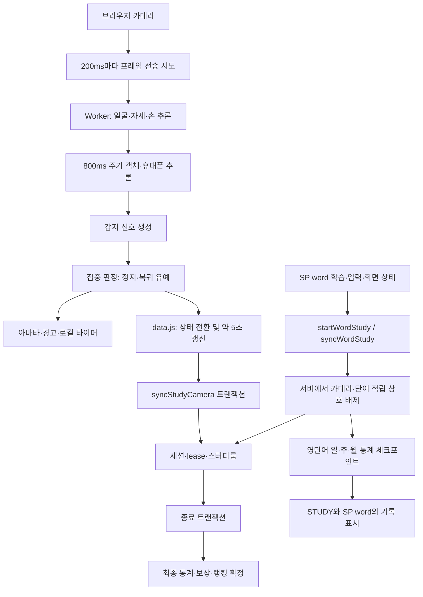

# 카메라 학습·서버 보고·SP word 통신/동기화 개선 검토

검토일: 2026-10-24, 한국 시간. 작성·분석·검증은 Codex가 직접 수행했다.

## 1. 결론

기능을 삭제할 필요는 없다. 우선 고칠 부분은 **카메라 상태 전환의 전송 누락, SP word 저장 완료 대기의 조기 반환, 최대 학습시간 이후 요청 반복, 화면 시간과 서버 확정 시간의 불일치**다. 휴대폰 판정에는 같은 감지 결과를 여러 번 독립 관측처럼 사용하는 문제가 있다.

기존 단위 테스트 201개는 통과했다. 이와 별도로 현재 문제를 확인하는 진단 재현 5개도 모두 실행해 확인했다. 여기서 재현의 통과는 문제가 해결됐다는 뜻이 아니라, 문서에 적은 문제가 현재 구현에서 발생한다는 뜻이다.

이 문서는 개선안이다. 앱의 기능 코드와 서버 설정을 수정하거나 배포하지 않았다. 추가한 파일은 이 문서, 재현 스크립트, SP word 타이머 검토용 원본 사본이다.

## 2. 확인한 소스와 검증 범위

- STUDY 로컬 기준 커밋: `ca470a731b5017b100fdc32d3d390341e059fb9b`.
- 카메라: `camera.js`, `camera-worker.js`, `camera-inference.js`, `camera-focus.js`, `camera-idle.js`.
- 화면·통신: `data.js`, `word-time.js`, `client-cache.js`.
- 서버: `functions/index.js`, `functions/domain.js`, `functions/word-study.js`, `functions/session-lifecycle.js`, `functions/word-stats.js`, `functions/word-link-service.js`, `functions/room-service.js`의 관련 경로.
- SP word: 연결된 GitHub의 [study-integration.js](https://github.com/JunHyuk1203/superword/blob/main/study-integration.js), blob SHA `0f017140b47a3d23b2fd6eb4d7268389fb14086c`.
- SP word: [study-timer-core.js](https://github.com/JunHyuk1203/superword/blob/main/study-timer-core.js), blob SHA `068a616f5e445a4498f3a75f629e553023e32c93`. 재현용 사본은 `evidence/spword-timer-core.snapshot.mjs`에 보관했다. 사본 앞의 출처 주석 2줄 때문에 원본보다 줄 번호가 2 크다.

소스의 동작과 모의 시계·모의 추론·모의 통신으로 확인했다. 운영 배포본과 저장소 코드가 동일한지, 실제 휴대폰·저사양 기기의 정확도와 지연이 얼마인지는 측정하지 않았다. Firebase 에뮬레이터 통합 검증은 CLI 시작 후 출력과 결과를 얻지 못해 중단했다. 이를 서버 테스트 통과나 앱 실패로 해석하지 않는다.

## 3. 현재 연결 구조



영상이나 얼굴 좌표를 SP word에 보내는 구조는 아니다. 카메라 영상은 기기에서 처리하고, 서버가 학습 세션·시간·단어 학습 소유권을 관리한다. SP word는 서버의 영단어 통계와 체크포인트를 읽는다. SP word 자체 기기 기록은 별도로 존재한다.

유지해야 할 기존 장점은 Worker 추론, 원본 영상 비전송, controllerId/sequence 검사, 서버 시각 기반 적립, 카메라·단어 전환 트랜잭션, 종료의 멱등성, 로컬 복구 기록이다. 아래 개선에서도 이 보호 장치를 유지한다.

## 4. 우선순위

| ID | 우선순위 | 문제 | 근거 수준 | 주요 수정 대상 |
|---|---|---|---|---|
| F01 | P1 | 통신 대기 중 정지→재개 전환이 서버 전송에서 사라짐 | 실행 재현 R5 | `data.js`, 카메라 동기화 API |
| F02 | P1 | SP word의 `await finish()`가 저장 전에 끝남 | 실행 재현 R1 | SP word 타이머·연동 코드 |
| F03 | P1 | 최대 시간에 도달하면 즉시 재개 요청을 반복함 | 실행 재현 R2 | SP word 타이머, `domain.js` |
| F04 | P1 | 화면 누적시간이 서버 확정시간으로 보정되지 않음 | 실행 재현 R3 | `data.js` |
| F05 | P2 | 캐시된 휴대폰 감지를 지속 관측으로 오인함 | 실행 재현 R4 | `camera-inference.js`, `camera-focus.js` |
| F06 | P1 | SP word 생존 만료가 통신 왕복 지연에 취약함 | 코드·시간선 분석 | SP word 타이머, 단어 세션 서버 |
| F07 | P2 | 5초 체크포인트가 연관 조회·쓰기를 계속 유발함 | 코드 분석, 운영 비용 미측정 | `data.js`, 서버 세션·통계 경로 |
| F08 | P2 | 객체 추론이 얼굴 결과 전달까지 지연시킴 | 코드 분석, 기기 성능 미측정 | `camera-inference.js`, Worker |
| F09 | P2 | 만료 정리가 한 항목 오류와 일괄 만료량에 취약함 | 코드 분석, 장애 주입 미실행 | `functions/index.js` |
| F10 | P2 | 문서와 실제 만료·갱신 설정이 서로 다름 | 소스·문서 대조 | 관련 문서, 상수·계약 테스트 |

P1은 먼저 고쳐야 할 시간 정합성·복구 문제다. P2는 오판정·부하·장애 확대를 줄이는 후속 작업이다. 운영에서 모든 문제가 이미 발생했다고 단정하지 않는다.

## 5. 문제별 구체적 개선

### F01. 요청 대기 중 카메라 정지 구간이 전송에서 유실된다

**근거:** `data.js:367`의 `syncCamera()`는 `cameraSyncBusy`이면 바로 반환한다. `data.js:697`의 상태 이벤트는 전환 이력을 저장하지 않는다. `data.js:404`의 후속 처리도 현재 상태만 비교한다.

**재현:** tracking=true 요청의 응답을 보류한다. 그동안 tracking=false로 2초 정지한 뒤 true로 복귀시킨다. 전송된 요청은 `[true, true]`이고 false 요청은 없다. 서버는 이 정지 구간을 알 수 없어 기존 lease 안의 시간을 적립할 수 있다.

**수정 방법:**

1. `data.js`의 단일 busy 플래그 옆에 상태 전환 대기열을 둔다. 최소한 `sessionId`, `controllerId`, `clientEpoch`, `eventId`, `sequence`, `tracking`을 보관한다.
2. 같은 상태의 반복 heartbeat는 합쳐도, 정지→재개 경계는 합치지 않는다. 정지 처리를 확인하기 전에는 재개 처리를 완료한 것으로 표시하지 않는다.
3. 재시도는 같은 eventId를 사용한다. 서버는 controller별 순서와 중복을 검사하고 이미 처리한 전환의 결과를 반환한다.
4. 현재 상태 갱신과 전환 이력의 처리 규칙을 API에 명시한다. 단순히 sequence가 큰 마지막 요청만 채택하면 중간 정지는 여전히 유실될 수 있다.
5. 브라우저가 보낸 과거 시간만 믿고 보상 시간을 소급 차감·적립하지 않는다. 네트워크 도착 전의 실제 정지 시각을 서버가 정확히 알 수 없다는 한계를 유지하고, 서버 관측 구간과 로컬 예상 구간을 구분한다.

**완료 기준:** 지연 응답 중 정지→재개→정지가 일어나도 모든 의미 있는 경계가 처리된다. 요청 중복·역순 도착·세션 교체가 있어도 종료된 세션을 되살리지 않는다. 네트워크 지연에 따른 잔여 시간 오차의 허용 범위를 별도로 명시한다.

### F02. SP word의 저장 완료 대기가 실제 완료를 보장하지 않는다

**근거:** SP word `study-timer-core.js:18-24`에서 busy이면 `Promise.resolve()`를 반환한다. `finish()`는 `update(false,true)`를 그대로 반환한다. 연동 코드 `study-integration.js:223` 이후 로그인 처리와 연동 해제 등은 이 Promise를 기다린다.

**재현:** heartbeat를 대기시킨 상태에서 `await timer.finish()`를 실행하면, 최종 저장 호출 횟수는 0인데 await가 끝난다. 이후 heartbeat가 완료되어야 종료가 수행된다.

**영향:** 종료가 큐에 남아 있는데 다음 계정 처리나 UI 전환을 시작할 수 있다. 연동 해제 경로에는 record 잔존 검사가 있어 잘못된 해제를 막는 방어가 있지만, 사용자에게 불필요한 저장 대기 오류를 보여줄 수 있다. 모든 호출자가 이 방어를 갖춘 것은 아니다.

**수정 방법:**

1. `update()`가 현재 작업과 뒤이어 처리할 정지·종료까지 완료되는 동일한 drain Promise를 반환하도록 바꾼다. busy일 때 빈 완료 Promise를 반환하지 않는다.
2. `run()`의 재귀 호출과 외부 pending을 하나의 명시적 실행 루프로 정리한다. 실행 중 변경된 desired/finishing을 반영한 뒤에만 drain을 완료한다.
3. 저장 실패는 record를 남기고 호출자에게 실패 또는 pending 상태를 전달한다. 오류 문자열만 바꾼 뒤 완료처럼 반환하지 않는다.
4. 계정·연동 컨텍스트 변경에 epoch를 둔다. `begin()`의 늦은 응답이 전역 `linkedTracker.desired`를 바꾸지 않도록 요청을 만든 타이머 인스턴스를 캡처하고, 응답 시 소유 계정과 epoch를 다시 검사한다.
5. Google 팝업은 클릭 이벤트 안에서 열어야 하는 현재 동작을 유지하되, 팝업 완료로 인증 계정이 바뀌는 시점과 이전 세션 정리를 함께 다루는 전환 상태를 둔다.

**완료 기준:** heartbeat/start 대기 중 호출한 finish의 Promise는 해당 종료의 확인 또는 명시적 실패 이후에만 끝난다. 저장 중 로그인 변경·로그아웃·연동 해제를 해도 다른 계정 타이머가 변경되지 않는다.

### F03. 최대 학습시간에 도달하면 재개 요청이 지연 없이 반복된다

**근거:** `functions/domain.js:11-26`의 체크포인트는 시작 후 12시간이 지나면 tracking=true 요청에도 activeSinceMs=null을 반환한다. SP word `study-timer-core.js:60`은 서버 tracking과 desired가 다르면 즉시 다시 `run()`을 호출한다.

**재현:** 서버가 계속 정지 상태를 반환하도록 하고 시계를 고정했다. 단 한 번의 update에서 heartbeat 간격을 기다리지 않고 sync가 4번 호출됐다. 진단에서는 네 번째 요청에 의도적으로 오류를 넣어 반복을 중단했다. 실제 시간 한도 도달 경로의 동일한 상태 불일치를 재현한 것이다.

**수정 방법:** 서버 응답에 `terminalReason:'max-duration'` 같은 안정적인 종료 사유와 `canResume:false`를 추가한다. 타이머는 이 응답에서 세션을 확정 종료하고, 실제 학습을 계속하는 경우에만 새 세션을 한 번 생성한다. 서버가 다른 이유로 재개를 거절해도 무한 재귀 대신 제한된 재시도와 backoff를 적용한다. 한국어 오류 문구 정규식으로 상태를 판별하는 경로도 구조화된 사유로 전환한다.

**완료 기준:** 12시간 경계, 종료된 세션, 영구적인 재개 거절에서 호출이 폭주하지 않는다. 한도 이전 기록은 한 번만 확정되고 새 세션과 겹치지 않는다.

### F04. 로컬 화면 시간이 서버 확정값과 계속 달라질 수 있다

**근거:** `data.js:54-67`에서 cameraDisplay.totalMs는 최초 생성 이후 로컬 실행시간으로만 증가한다. `observeSession()`으로 새 accumulatedSeconds를 받아도 그 값으로 재기준을 잡지 않는다. `tests/timer-ui.test.mjs:307` 이후 기존 테스트도 이 동작을 허용한다.

**재현:** 로컬 3.5초에 정지하고 응답이 늦게 도착한 상황에서 서버 누적값 11초를 전달했다. 화면은 계속 `00:00:03`이다. 최종 기록·보상은 서버 값을 쓰므로 사용자가 본 시간과 저장 결과가 달라질 수 있다.

**수정 방법:**

1. 서버 확정값을 `confirmedMs`, 마지막 확인 이후 로컬 추정치를 `provisionalMs`로 분리한다.
2. 유효한 새 sequence 응답마다 confirmedMs와 기준 시각을 갱신한다. 이전 로컬 총합을 그대로 고정하지 않는다.
3. 표시되는 숫자가 무엇을 의미하는지 일관되게 정한다. 확정값보다 작은 로컬 숫자는 앞으로 보정하고, 아직 확정되지 않은 값은 동기화 중 상태로 표현한다.
4. 서버 응답 시각을 수신 시점의 현재 시각으로 그대로 취급하는 `sessionClock`·`wordClock`도 요청 왕복시간과 지연을 고려한다. 시계 추정 오차만으로 적립 lease를 화면에서 늘려 보이지 않게 한다.
5. 기존의 ‘화면이 되감기지 않는다’ 테스트와 함께 ‘최종 확정값으로 수렴한다’ 테스트를 추가한다.

**완료 기준:** 정상 통신, 지연 응답, 장시간 정지, SP word 전환 후 화면·완료 토스트·저장 통계가 같은 확정시간으로 수렴한다. 단순 정수 초 표시의 절삭 오차와 통신 중 예상치를 구별한다.

### F05. 휴대폰 캐시가 지속 사용 판정의 증거로 중복 사용된다

**근거:** `camera-inference.js:145-162`는 객체를 800ms마다 검사하고 이전 휴대폰을 최대 1.5초 범위에서 재사용한다. 그 사이 프레임에서도 phoneUse=true를 만든다. `camera-focus.js:3,38-40`은 phoneUse가 750ms 지속되면 휴대폰 사용을 확정한다.

**재현:** 2400ms 검사에만 휴대폰을 검출시켰다. 3200ms의 전체·확대 검사는 모두 빈 결과인데 이전 휴대폰 캐시로 phoneUse가 유지되어 정지가 확정됐다. 750ms 판정 문턱이 객체 재검사 주기 800ms보다 짧아 한 번의 감지를 여러 독립 관측처럼 쓰는 셈이다.

**수정 방법:** 객체 결과에 observationId, observedAt, fresh, confidence를 넣는다. 캐시는 화면 표시·추적 연속성을 위해 유지하되, 정지 확정에는 새 양성 관측 수와 새 음성 관측을 반영한다. 예를 들어 독립된 2회 양성 관측과 시간 조건을 함께 요구하고, 명시적인 새 음성 관측은 캐시 연속성보다 우선시한다. 최종 횟수·문턱은 실제 장면으로 검증한다.

**완료 기준:** 단발 오검출·새 음성 관측·책상 위 휴대폰·손에 든 휴대폰·얼굴 가림을 각각 구분해 검증한다. 휴대폰 감지와 자동 정지 기능은 유지한다.

### F06. SP word의 세션 생존이 느린 통신에 취약하다

**근거:** `functions/domain.js:7-8`에서 카메라 생존은 45초, 단어 lease는 10초다. 단어 세션은 presence에도 동일한 10초를 사용한다. `functions/word-study.js:82`는 갱신 전에 만료 세션을 정리한다. SP word 타이머 `study-timer-core.js:37,47`은 응답을 받은 시각으로 lastSync를 설정한다.

**발생 시간선 예:** 서버가 t=0에 10초 유효 구간을 부여하고 응답이 4초 뒤 도착한다. 클라이언트는 그때부터 5초를 기다려 t=9에 다음 요청을 보낸다. 요청 전달에 다시 4초가 걸리면 서버에는 t=13에 도착한다. 계속 학습 중이어도 이전 세션은 만료 대상이다. 콜드 스타트·순간적인 통신 지연이 추가되면 더 불리하다. 이 시간선은 코드 분석이며 실제 회선 측정값은 아니다.

**수정 방법:**

1. 카메라처럼 단어도 ‘세션 소유권 생존 시간’과 ‘적립 가능한 시간’을 분리한다. 예를 들어 presence에 더 긴 유예를 주더라도 무응답 적립 한도 10초는 유지한다.
2. heartbeat를 응답 완료 후 고정 5초 대기 방식에서 단조 시계의 송신 기준 일정과 서버 만료까지의 여유를 반영하는 방식으로 바꾼다. 중첩 실행은 막고 지연된 요청 뒤에는 다음 갱신을 적절히 앞당긴다.
3. 실패 backoff와 lease 만료 상태를 분리한다. 연결 복구 시 소유권 확인 후 새 적립 구간을 열며, 오프라인 시간을 서버 보상으로 소급하지 않는다.
4. 계정별 heartbeat에 작은 jitter를 넣고 오류 종류에 따라 backoff를 적용해 재접속 동시 폭주를 줄인다.

**완료 기준:** 왕복 지연 0.1/2/8/15초, 응답 유실, 일시 오프라인에서도 중복 적립이 없고 상태가 복구된다. 카메라와 단어가 같은 시간 구간을 동시에 적립하지 않는다.

### F07. 5초 갱신에 연결된 DB 작업과 화면 재조회가 많다

**근거:** `syncStudyCamera`와 `syncWordStudy`는 먼저 `expireUserSessions()`를 호출한다. 이 함수는 프로필과 연결된 세션들을 읽고, 이후 본 트랜잭션이 다시 관련 문서를 읽는다. 단어 sync는 카메라 문서·프로필·통계·lease·스터디룸도 갱신한다. `data.js:511-512`는 단어 presence 변경 때 카메라 sync를 유발하고, `data.js:532,538`은 studyRevision 변경에 따라 보이는 통계를 다시 조회한다.

단어 heartbeat는 정상 지속 학습에서 약 12회/분이다. 카메라가 함께 살아 있으면 카메라 정기 갱신과 단어 변경에 따른 갱신도 발생할 수 있다. 요청 수를 합쳐 한 번 호출한다고 문서 읽기·쓰기 비용이 자동으로 사라지지는 않는다. 현재 `statsRevision()`은 완료 시에만 바뀌는 보상·랭킹의 캐시를 유지하는 최적화가 있으므로 보존한다.

**수정 방법:**

1. hot path에서 만료 검사와 현재 세션 갱신에 필요한 읽기를 한 트랜잭션으로 통합하는 방향을 검토한다. 세션 시작과 백그라운드 정리의 넓은 복구 검사는 유지한다.
2. `wordPresenceUntilMs` 갱신만으로 카메라의 의미 상태가 바뀌지 않으면 추가 카메라 상태 전송을 생략한다. 카메라 자체 presence 갱신과 단어 만료 후 재개는 계속 보장한다.
3. 서버 응답 또는 하나의 통계 스냅샷으로 현재 화면의 관련 값을 갱신해 동일 revision의 일·주·월 통계를 중복으로 읽지 않는다. 두 앱의 최종 통계 일관성은 유지한다.
4. 스터디룸 참여자가 여러 명일 때 한 방 문서 전체 members/studyTotals를 서로 갱신하는 충돌률을 측정한다. 충돌이 높을 때 참여자별 활동 문서와 집계 표시의 분리를 검토한다.
5. 함수 설정은 현재 `maxInstances:2`, `concurrency:1`이다. 각 함수에 대해 평균 처리시간 L초라면 이론상 처리량 상한은 약 2/L 요청/초다. 실제 트랜잭션 충돌·대기·콜드 스타트를 포함한 p95/p99를 측정한 뒤 인스턴스·CPU·동시성을 조정한다.

**완료 기준:** 단일/두 앱 동시 사용, 같은 방 10명·50명 등 정한 부하에서 요청/분, 읽기·쓰기/분, 트랜잭션 재시도, p95/p99가 개선된다. 이 수치는 아직 측정하지 않았으므로 비용 절감률을 단정하지 않는다.

### F08. 무거운 객체 추론이 얼굴 판단과 화면 응답도 막는다

**근거:** `camera-inference.js:141-168`은 얼굴·자세·손 추론 뒤 COCO 전체 검사와 필요한 경우 확대 검사를 모두 기다린 후 결과를 반환한다. `camera.js:205-218`은 inFlight가 끝나야 다음 프레임을 보낸다. 객체가 느리면 얼굴이 이미 감지됐어도 얼굴 결과가 UI로 늦게 도착한다. 3초가 넘으면 오래된 결과 처리·watchdog 정지로 이어질 수 있다.

**수정 방법:** 얼굴 신호를 빠른 주기로 전달하고, 손·자세·객체는 별도 주기로 실행해 최신 결과를 시각·유효기간과 함께 결합한다. 모델별 입력 크기와 처리시간을 측정하고 저사양 모드에서 주기를 조정한다. 하나의 Worker에 계산이 몰려 여전히 막히면 객체 전용 Worker 분리를 측정 후 적용한다. 메인 스레드로 추론을 옮기거나 휴대폰 검사를 삭제하지 않는다.

**추가 정확도 검증:** `extractFocusSignals()`는 얼굴 기하 계산에 정규화 x/y 좌표를 그대로 사용한다. 가로·세로 비율이 바뀌면 눈 종횡비 등 고정 문턱의 의미가 달라질 수 있다. 픽셀 또는 종횡비를 보정한 좌표로 계산하고 세로 화면·안경·조명·독서 자세별 오탐/누락을 측정한다. 22.5초 정지 상태만으로 집중 여부를 정확히 증명할 수 없으므로, 현재 자동 판정을 유지하면서 신호 품질·독립 관측·상태 복귀 조건을 검증한다.

**완료 기준:** 모델별 추론 지연과 결과 age를 기록한다. 객체 지연·실패가 얼굴 결과 전달 전체를 멈추지 않으며, 오래된 객체 결과로 새 행동을 확정하지 않는다. 실제 기기 성능 개선은 측정 후 판단한다.

### F09. 만료 세션 정리가 한 항목 오류와 일괄 만료량에 취약하다

**근거:** `functions/index.js:168-174`는 분당 최대 100개를 순차 처리하고 개별 항목의 오류를 분리하지 않는다. 한 finishSession이 예외를 던지면 그 실행의 뒤쪽 항목 처리가 중단된다. 100개보다 많은 세션이 동시에 만료되면 여러 실행에 나뉘어 처리된다.

**수정 방법:** 항목별 예외를 기록하고 다음 항목을 계속 처리한다. 없는 세션·이미 종료된 세션의 잔여 lease는 조건부로 정리한다. 실행 시간 예산 안에서 페이지를 추가 처리하고, 처리 수·실패 수·가장 오래된 미처리 만료 시각을 남긴다. 갱신된 세션은 종료 트랜잭션 안에서 다시 확인하는 현재 보호를 유지한다. 대량 Promise.all로 트랜잭션을 무제한 실행하지 않는다.

**완료 기준:** 한 항목의 강제 오류 뒤 나머지가 처리된다. 250개 동시 만료를 정해진 시간 내 정리한다. 정리 도중 갱신한 세션은 살아 있다. 마지막 유효 적립 구간 이후 시간이 더해지지 않는다.

### F10. 설정의 실제 값과 문서 설명이 다르다

**근거:** 현재 카메라는 적립 lease 10초·세션 presence 45초다. 그런데 `docs/word-integration.md`에는 카메라·일반·단어가 모두 10초 무응답에 만료된다고 적혀 있다. `docs/firebase.md`에는 20초 갱신/30초 lease 및 다른 이전 설명도 남아 있다. 실제 클라이언트는 5초 갱신 조건을 사용한다.

**수정 방법:** creditLeaseMs, sessionPresenceMs, heartbeatMs, retry 정책, 최대시간을 의미별로 구분한 계약 표를 하나 만든다. 클라이언트·서버가 같은 계약 버전을 사용하도록 하고, 서버의 응답에 해당 버전과 재개 가능 여부를 포함한다. 구형 `prepareWordStudy` 경로는 유지하면서 호환성 테스트를 둔다. 문서와 코드 상수를 대조하는 작은 검증을 추가한다.

**완료 기준:** 카메라·일반 학습·SP word 각각의 적립 종료, 세션 만료, 백그라운드 정리 시점이 문서와 테스트에서 일치한다.

## 6. 기능을 유지하는 적용 순서

1. **종료·반복 제어:** F02와 F03을 먼저 수정한다. SP word의 drain Promise, 계정 epoch, terminalReason을 추가하고 기존 API 응답 필드는 유지한다.
2. **시간 정합성:** F01과 F04를 함께 수정한다. 전환 대기열·중복 방지와 서버 확정시간 표시를 함께 검증해야 화면만 정상처럼 보이는 상태를 피할 수 있다.
3. **단어 연결 복구:** F06을 적용한다. 단어 presence와 credit lease를 분리하고 단어→카메라 소유권 전환의 원자성을 다시 검사한다.
4. **판정 신뢰도:** F05와 F08을 적용한다. 신선한 관측과 캐시를 구분하고 모델별 주기를 나누며, 기존 얼굴·수면·휴대폰·멍때림 자동 판정은 유지한다.
5. **운영 안정성:** F07·F09·F10을 적용하고 부하·장애·문서 계약 검증을 완료한다.

프로토콜 변경은 서버가 신·구 클라이언트를 모두 받는 버전을 먼저 배포하고, 두 앱을 차례로 갱신한다. 구형 호출 지원을 제거하지 않는다. 롤백 때도 서버에 이미 확정된 시간·통계·보상 기록을 삭제하거나 재적립하지 않는다.

## 7. 추가해야 할 검증표

| 상황 | 확인할 결과 |
|---|---|
| 정지→재개가 heartbeat 대기 중 발생 | 의미 있는 전환 누락 없음, 서버 확정시간과 화면 수렴 |
| start/sync 대기 중 저장·종료 | finish 대기가 저장 결과까지 유지됨 |
| 저장 중 로그인 계정 교체·연동 해제 | 이전 응답이 새 타이머·계정 상태를 변경하지 않음 |
| 12시간 한도 직전·직후 | 요청 반복 없음, 확정은 한 번, 필요 시 새 세션 한 번 |
| 응답 지연·유실·중복·역순 | 소유권·순서 검사 유지, 이미 종료한 세션 재활성화 없음 |
| SP word 진입·메뉴·10초 무입력·종료·강제 종료 | 카메라와 단어의 동일 구간 이중 적립 없음 |
| 수동 일시정지 후 SP word 종료 | 수동 정지가 자동 재개로 풀리지 않음 |
| 휴대폰 단발 감지 뒤 새 음성 관측 | 캐시만으로 사용 확정하지 않음 |
| 객체 모델 지연·실패와 얼굴 정상 | 얼굴 상태 전달과 경고가 무기한 막히지 않음 |
| KST 자정·주·월 경계 | 두 앱의 날짜별·기간별 통계와 종료 합계 일치 |
| 기기 시계 ±5분 변경 | 서버 적립 영향 없음, 예상 표시가 lease를 임의 연장하지 않음 |
| 만료 250개 중 한 항목 실패 | 나머지 처리 지속, 갱신된 세션 보존 |
| 저사양 모바일·세로 화면·안경·독서 자세 | 오탐/누락률·지연·배터리 사용량 기록 |

## 8. 이번에 실행한 검증과 재현 방법

### 기존 검증

`npm run test:unit`: **201개 통과, 실패 0, 건너뜀 0, 종료 코드 0**.

출력: 저장소 루트의 `.codex-camera-sync-review-unit.log`.

Firebase 통합 검증은 아래 명령으로 시도했지만 에뮬레이터 CLI 시작 결과를 얻지 못해 중단했다. 전체 서버 통합 테스트의 성공 여부는 이번 검토에서 확정하지 못했다. `.codex-camera-sync-review-firebase.log`에는 유효한 진단 결과가 없다.

```powershell
npm run test:firebase
```

### 문제 재현

```powershell
node --test docs/reviews/evidence/reproduce-camera-sync.mjs
```

**5개 재현 확인, 실패 0, 종료 코드 0.** 네트워크·카메라·운영 DB 연결 없이 실행한다. R1/R2는 검토한 SP word 원본 사본, R3/R5는 현재 STUDY 소스와 기존 UI 테스트 harness, R4는 현재 추론·판정 코드에 모의 모델을 주입한다.

| 재현 | 실제 관측값 |
|---|---|
| R1 | finish의 await가 끝났는데 최종 저장 호출 0회, heartbeat는 대기 중 |
| R2 | 시계 고정·update 1회에서 sync 4회 즉시 실행, 진단용 오류로 중단 |
| R3 | 화면 3초, 전달한 서버 확정 누적값 11초 |
| R4 | 다음 전체·확대 객체 검사 결과가 비어도 캐시로 phone 정지 확정 |
| R5 | 로컬 2초 정지 구간이 있었지만 전송 상태는 true, true |

출력: 저장소 루트의 `.codex-camera-sync-review-reproductions.log`. 스냅샷은 실행 중인 앱에서 import하지 않는다. 수정 후에는 이 진단 재현의 기대값을 정상 동작 기준으로 바꾸어 제품 회귀 테스트에 옮긴다.

## 9. 관측 지표

원본 영상·얼굴 좌표를 수집할 필요는 없다. 진단용으로 익명화한 세션 식별자, API 종류, 요청 sequence/eventId, 전환 전후 상태, 전환 사유, 송신·응답 단조 시각 차이, 응답 시 lease 잔여량, ignored·재시도·만료 횟수, 서버 확정시간과 표시시간의 차이, 모델별 추론시간·관측 age를 남기면 된다. 인증 토큰과 이메일은 진단 로그에 넣지 않는다.

이 지표로 먼저 정상 사용의 기준값을 측정하고, 개선 전후 같은 기기·시나리오에서 비교해야 정확도·안정성·비용 개선을 수치로 판단할 수 있다.
