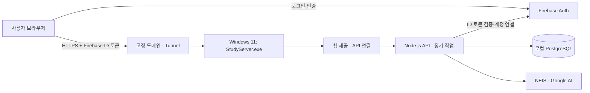

# STUDY 자체 서버 전환 계획 — Windows 11 · EXE 하나로 실행

작성일: 2026-10-24
상태: **초기 계획 보관본. 이후 사용자의 실행 요청에 따라 개발 파일 백업과 구현을 시작했다. 현재 실행 방법은 `server/README.md`를 기준으로 한다.**

후속 확정 사항: 계정·로그인은 Firebase Auth 유지, 웹은 GitHub Pages 유지, 기존 Firestore 데이터 이관 생략, EXE는 API·DB만 실행. DNS는 다른 업체에서 관리하므로 직접 HTTPS 또는 별도 Tunnel 구성을 선택한다. 아래의 웹 자체 호스팅·전체 클라우드 데이터 이관 부분은 현재 실행 범위에서 제외한다.

## 1. 확정한 방향

사용자는 Windows 11에서 `StudyServer.exe` 하나를 직접 열어 서버를 실행한다. 실행하면 필요한 구성요소가 함께 켜지고, 종료하면 서버가 꺼지는 형태다.

**계정 생성·인증·로그인·Google 로그인·인증 메일·비밀번호 재설정은 현재 Firebase Auth에 그대로 남긴다.** 사용자 UID도 유지한다. 자체 로그인 시스템이나 메일 서버는 만들지 않는다.

학습 기록, 통계, 랭킹, Focus Time, 학교 정보 캐시, 학습 계획, 친구·스터디룸, AI 예산·브리핑, 서버 API와 두 개의 정기 작업은 자체 서버로 이전한다. 웹 화면도 같은 EXE가 제공하도록 구성하여 최종적으로 STUDY의 웹·API·DB를 한 프로그램으로 실행한다.

Windows 서비스 등록, 부팅 시 자동 실행, 로그인 전 실행, 업데이트·재부팅 후 자동 복구는 이번 설계에 포함하지 않는다. PC가 켜져 있고 사용자가 EXE를 실행한 동안 서비스한다. 백업과 이전 실패 시 되돌리는 절차는 데이터 보존을 위해 계획에 포함한다.

이 문서는 앞선 자체 서버 검토의 여러 선택지 중 **Firebase Auth 유지 + 나머지 STUDY 서버 이전 + 수동 EXE 실행**을 선택한 구체안이다.

## 2. 사용자가 보게 될 실행 방식

### 최초 한 번

1. `StudyServer.exe`를 실행한다.
2. 설정 화면에서 Firebase 프로젝트 연결용 파일, 외부 접속용 터널 정보, NEIS·AI API 키를 등록한다. 비밀 값은 화면에서 가리고 로그에 출력하지 않는다.
3. 준비된 이전 데이터 파일을 선택한다. 검사 결과와 가져올 데이터 건수를 확인한 뒤 초기 DB로 가져온다.
4. 외부 주소 연결 검사를 통과하면 초기 설정을 완료한다.

도메인 소유 확인과 터널 발급은 외부 서비스 계정에서 최초 한 번 해야 한다. EXE가 도메인 소유권이나 공유기 권한 없이 이를 자동으로 획득할 수는 없다. 설정 화면에서 필요한 항목과 공식 설정 페이지를 안내하고, 발급받은 정보만 입력하도록 한다.

### 이후 매번

`StudyServer.exe` 더블클릭 → DB 시작 → API 시작 → 웹 시작 → 외부 연결 → **운영 중** 표시.

창에는 다음 항목만 기본으로 표시한다.

| 표시·버튼 | 동작 |
|---|---|
| 서버 상태 | 시작 중 / 운영 중 / 외부 연결 끊김 / 오류 / 중지 |
| 접속 주소 | `https://study.junhyuk.site`와 복사 버튼 |
| 사이트 열기 | 브라우저에서 실제 접속 주소 열기 |
| 백업 | DB·설정의 새 백업 만들기 |
| 설정 | 연결 정보, 백업 위치, 상세 진단 확인 |
| 서버 종료 | 진행 중 요청을 정리하고 DB까지 종료 |

창 최소화는 실행을 유지한다. 창의 닫기 버튼은 서버 종료 절차를 실행한다. 중복으로 EXE를 열면 기존 창을 보여주고 두 번째 서버는 시작하지 않는다.

**배포 파일이 EXE 하나라는 뜻이며, DB까지 EXE 내부에 계속 저장한다는 뜻은 아니다.** 첫 실행 시 필요한 내부 프로그램을 풀고, 사용자 데이터는 별도 폴더에 보관한다. EXE를 교체해도 DB는 남아야 한다.

## 3. 현재 확인한 범위와 추가 확인 항목

### 소스에서 확인한 사실

- 작업 폴더: `C:\Users\tntdr\OneDrive\문서\ChatGPT\study`.
- Firebase 프로젝트: `study-junhyuk1203-20261021`.
- Firestore DB: `study-data`, 설정상 Enterprise Native, 서울 리전.
- 현재 도메인: `study.junhyuk.site` (`CNAME` 기준).
- 서버 진입점: Callable API **24개**, 매분 실행하는 정기 작업 **2개**.
- 브라우저가 Firebase Auth 외에 Firestore 조회·구독과 Callable API에도 직접 의존한다.
- 외부 단어앱 저장소 이름은 `superword`, 인증 프로젝트는 `goodnotesword-454fa`다.
- 카메라·단어 학습은 현재 **5초 heartbeat, 10초 적립 lease, 45초 연결 유예, 최대 12시간** 계약을 사용한다. 일반 학습의 연결 유예는 10초다.
- `.gitignore`에 비밀 파일·의존성·임시 파일 등이 제외되어 있고, Git 미추적 검토 자료도 존재한다. Git 저장소 복제만으로 전체 로컬 백업이 되지 않는다.

근거: `auth.js`, `data.js`, `study-api.js`, `integrations.js`, `firebase.json`, `functions/index.js`, `functions/word-link.js`, `functions/domain.js`, `docs/study-sync-contract.md`, `docs/word-integration.md`.

### 실제 작업 시작 전에 채울 정보

| 항목 | 확인할 내용 | 기본안 |
|---|---|---|
| Windows | x64/ARM64, 현재 계정 권한, 디스크 여유 | Windows 11 x64·일반 사용자 실행을 우선 대상으로 제작 |
| 서버 PC | CPU·RAM·SSD, 다른 프로그램과 함께 쓰는지 | 정해진 최소 성능을 주장하지 않고 실제 PC에서 검증 |
| 인터넷 | 공유기 수, 통신사, 업로드 속도, CGNAT 여부 | 터널 방식으로 공인 IP 의존 줄이기 |
| 도메인 | DNS 관리 계정과 현재 레코드 | 기존 주소 유지 |
| 데이터 | 계정 수, 문서 수, DB 용량, 활성 세션 수 | 전체 원본 백업 후 변환 |
| 백업 위치 | 외장 저장장치 또는 다른 PC·외부 저장소 | 서버 디스크 외부에 사본 1개 이상 |
| 단어앱 | 실제 서비스 주소, WebView 출처, 수정·배포 범위 | 로그인은 유지하고 STUDY 호출 경로만 함께 변경 |

현재 PC가 나중에 사용할 서버인지, DNS가 어느 업체에 있는지, 실제 운영 데이터 규모는 확인하지 않았다. 이 문서에 적힌 기본안은 해당 정보가 확인되면 값만 확정할 수 있도록 설계했다.

## 4. EXE 내부 구성



| 구성요소 | 역할 | 실행 방식 |
|---|---|---|
| C#/.NET 데스크톱 런처 | 시작·종료·설정·백업·상태 화면 | self-contained 단일 EXE |
| Node.js | 기존 JavaScript 업무 로직과 API | 동봉한 런타임을 자식 프로세스로 실행 |
| PostgreSQL | 데이터·집계·트랜잭션 | Windows 바이너리를 동봉하고 사용자 계정에서 실행 |
| Caddy | 정적 웹 제공, `/api`를 Node로 연결 | 동봉한 실행 파일을 자식 프로세스로 실행 |
| cloudflared | 외부 HTTPS 주소를 로컬 웹에 연결 | 기본 네트워크 방식에서만 함께 실행 |

기존 JavaScript 계산 로직을 유지하기 위해 Node.js를 사용한다. 런처는 서버 업무 로직을 다시 구현하지 않는다. WPF 등 일반 Windows 데스크톱 UI로 제작하며, 사용자가 Node.js·PostgreSQL·.NET을 각각 설치하거나 터미널 명령을 입력하지 않도록 배포 패키지에 포함한다.

.NET의 self-contained 단일 파일 배포와 PostgreSQL의 Windows 바이너리 배포가 제공된다. 실제 선택 버전과 필요한 DLL은 **개발 도구가 없는 깨끗한 Windows 11에서 실행 시험한 조합으로 고정**한다. 단일 파일 옵션만 켜면 제3자 프로그램까지 자동 포함되는 것은 아니므로, Node·DB·프록시·터널 바이너리는 별도 내장 리소스로 패키징해야 한다. [Microsoft 단일 파일 배포](https://learn.microsoft.com/en-us/dotnet/core/deploying/single-file/), [PostgreSQL Windows 배포](https://www.postgresql.org/download/windows/)

### 저장 경로와 포트

실제 데이터는 OneDrive 동기화 폴더와 EXE 파일 위치에서 분리한다. 기본 경로는 Windows의 LocalApplicationData API로 구한다.

```text
%LOCALAPPDATA%\StudyServer\
  runtime\<release-id>\  동봉 프로그램·웹·서버 코드
  data\postgres\        DB 본체
  config\               연결 설정·보호된 비밀 정보
  backups\              임시 백업 보관 위치
  logs\                 제한된 용량의 실행 로그
```

| 용도 | 기본 주소 | 외부 공개 |
|---|---|---|
| 웹·프록시 | `127.0.0.1:18080` | 터널을 통해서만 |
| Node API | `127.0.0.1:18081` | 하지 않음 |
| PostgreSQL | `127.0.0.1:15432` | 하지 않음 |

포트가 이미 사용 중이면 다른 프로그램을 종료시키지 않는다. 런처가 충돌을 설명하고 설정된 대체 포트를 적용한 뒤 내부 연결을 함께 갱신한다. DB 접속은 암호 인증을 사용하고 `trust` 방식으로 열지 않는다.

실행 전 파일 해시와 설정을 검사하고, DB가 응답한 뒤 API·웹·터널을 순서대로 시작한다. 최초 DB 초기화는 데이터 폴더가 비어 있을 때만 한다. 기존 DB가 열리지 않는다고 새 DB로 덮어쓰거나 초기화하지 않는다.

정상 종료 시 신규 요청을 막고, 진행 중 학습 저장·AI 요청을 제한된 시간 동안 정리한 후 웹·API·DB를 종료한다. 즉시 강제 종료를 기본 동작으로 삼지 않는다. PostgreSQL의 시작·종료 도구를 이용할 수 있으며 Windows 서비스 등록 기능은 사용하지 않는다. [PostgreSQL pg_ctl](https://www.postgresql.org/docs/current/app-pg-ctl.html)

## 5. 네트워크 설정 계획

### 기본안: 고정 도메인 + Cloudflare Tunnel

EXE 하나로 켜는 사용 방식에 맞춰, 공유기 인바운드 포트포워딩이 필요 없는 터널을 우선안으로 한다. 자체 서버의 데이터와 처리는 Windows PC에 있고, 외부 접속 경로는 Cloudflare를 이용하는 구성이다. Firebase Auth·DNS·터널·외부 AI까지 모두 자체 운영한다는 의미는 아니다.

최종 경로는 다음과 같다.

```text
https://study.junhyuk.site/
  → Cloudflare Tunnel
  → http://127.0.0.1:18080/
      웹 파일 제공
      /api/* → http://127.0.0.1:18081/api/*
```

최종 웹과 API가 같은 출처이므로 STUDY 웹에서는 상대 주소 `/api/...`를 사용한다. 현재 웹 주소를 유지하면 같은 브라우저의 Firebase 로그인 저장소도 같은 출처를 유지할 수 있다. 실제 로그인 지속 여부는 전환 시험에서 확인한다.

### 최초 네트워크 설정 순서

1. 현재 DNS의 A·AAAA·CNAME·TXT·MX·CAA 등 모든 레코드와 관리 계정을 백업한다.
2. Cloudflare에서 고정 공개 호스트를 연결할 수 있는 DNS 구성을 확인한다. 네임서버 이전이 필요하면 기존 레코드를 모두 옮긴 뒤 검증한다. 지금 DNS 제공자가 Cloudflare라고 가정하지 않는다.
3. 테스트용 하위 도메인과 고정 Tunnel을 먼저 준비한다. 테스트 서버와 운영 서버는 별도 DB·터널을 사용한다.
4. Tunnel의 공개 호스트를 로컬 `http://127.0.0.1:18080`에 연결한다. 다른 주소·포트를 임의로 공개하지 않는다.
5. Tunnel 자격 정보를 런처에 등록한다. 공개 웹 파일이나 Git에 넣지 않고 현재 Windows 사용자만 읽을 수 있는 설정으로 저장한다.
6. 같은 공유기 밖의 휴대폰 모바일 데이터로 HTTPS, 로그인, API, AI 스트리밍을 시험한다.
7. 최종 데이터 전환을 완료한 시점에만 운영 도메인을 새 연결로 바꾼다. 무료 임시 `trycloudflare` 주소는 고정 운영 주소로 사용하지 않는다.

Tunnel은 서버에서 외부로 연결하며, 공식 문서상 연결에 7844 포트의 TCP/UDP 경로를 사용한다. UDP가 막힌 환경에서는 지원되는 TCP 연결을 시험한다. 정확한 목적지 목록은 실행 시 공식 목록으로 확인한다. [Cloudflare Tunnel 연결 검사](https://developers.cloudflare.com/cloudflare-one/networks/connectors/cloudflare-tunnel/troubleshoot-tunnels/connectivity-prechecks/)

| 구간 | 허용할 통신 | 설정 원칙 |
|---|---|---|
| 외부 사용자 → 공개 도메인 | HTTPS 443 | 브라우저는 공개 HTTPS 주소만 사용 |
| 서버 → Tunnel | 7844 TCP/UDP | 선택한 프로토콜과 공식 목적지에 맞춰 허용 |
| 서버 → Firebase·Google AI·NEIS | HTTPS 443 | 기존 API의 외부 연결 유지 |
| 서버의 이름 해석·시각 확인 | 사용 중인 DNS·시간 동기화 경로 | 서버 시각 오류가 토큰·학습시간에 영향을 주므로 확인 |
| 공유기 → 서버 PC | 새 인바운드 개방 없음 | DMZ·전체 포트 개방을 사용하지 않음 |
| Node·DB | 로컬 loopback만 | 방화벽 예외로 전체 네트워크에 공개하지 않음 |

EXE 기본안에서는 사용자가 Windows 방화벽을 끄거나 관리자 권한으로 프로그램을 실행할 필요가 없도록 설계한다. 회사·학교·보안 프로그램이 아웃바운드를 제한하면 그 환경의 관리자 설정이 별도로 필요할 수 있다.

### 대안: 공인 IP + 공유기 포트포워딩

터널을 사용하지 않으려면 다음 설정이 추가된다. EXE 실행만으로 공유기와 통신사 설정까지 해결되는 방식은 아니다.

| 점검·설정 | 구체적인 처리 |
|---|---|
| 공인 IP 확인 | 공유기 WAN 주소와 외부에서 관측되는 IP 비교. 사설 IP나 `100.64.0.0/10` 등 CGNAT이면 통신사 공인 IP 제공 여부부터 확인 |
| 이중 공유기 | 상위 공유기·모뎀까지 경로 확인. 브리지 또는 두 단계 전달 가능성을 검토 |
| 내부 주소 | 공유기 DHCP 예약으로 서버 PC 주소 고정 |
| DNS | A 레코드를 공인 IPv4에 연결. 동적 IP면 갱신 절차 필요 |
| IPv6 | 실제 연결·방화벽 검증 없이 AAAA 레코드를 추가하지 않음 |
| 공유기 | 필요한 TCP 80·443만 서버의 Caddy로 전달 |
| Windows 방화벽 | 선택한 Caddy 실행 파일과 80·443만 허용. Node·DB 포트는 열지 않음 |
| 인증서 | Caddy의 공개 도메인 인증서 발급·갱신 확인. 80 차단 환경은 가능한 인증 방식과 443 경로를 별도 검증 |
| 내부 테스트 | NAT loopback 미지원 시 내부에서만 실패할 수 있으므로 모바일 데이터와 나누어 검사 |

Windows 방화벽 규칙 생성 등에는 최초 관리자 작업이 필요할 수 있다. 이 대안을 채택하면 기본 터널 모드와 동시에 켜지 않도록 런처에서 네트워크 모드를 구분한다. Caddy의 자동 HTTPS는 DNS와 인증서 검증에 필요한 네트워크 접근 조건을 충족해야 한다. [Caddy 자동 HTTPS](https://caddyserver.com/docs/automatic-https)

### 웹·API 네트워크 세부 조건

- `/api/*`와 사용자별 응답은 CDN 공유 캐시에서 제외한다. 로그인 사용자 데이터가 다른 사용자에게 재사용되지 않게 한다.
- 정적 파일은 릴리스 버전으로 캐시를 구분하고, HTML은 새 배포를 확인할 수 있게 설정한다.
- 외부 단어앱은 실제 운영 출처를 조사해 CORS 허용 목록에 추가한다. `*` 또는 임의의 `null` 출처 허용으로 해결하지 않는다. CORS와 별개로 모든 API에서 토큰을 검증한다.
- 프록시가 넣은 원래 IP 헤더는 신뢰하는 프록시 경로에서만 사용한다. 임의의 클라이언트 헤더로 요청 제한을 우회하지 못하게 한다.
- AI 스트리밍과 상태 구독은 버퍼링을 피하고, 앱 수준의 주기적인 연결 유지 이벤트를 사용한다. 첫 응답 지연·중간 무응답·240초 AI 요청을 실제 터널 경로에서 시험한다. 플랫폼의 시간 제한을 keep-alive만으로 무조건 해결할 수 있다고 가정하지 않는다. [Cloudflare 연결 제한](https://developers.cloudflare.com/fundamentals/reference/connection-limits/)
- 공유기 관리 화면, Windows 원격 데스크톱, DB 관리 화면을 인터넷에 공개하는 설정은 필요하지 않다.

## 6. 이전 전에 수행할 전체 백업 계획

**여기서부터의 백업 절차 역시 아직 실행하지 않았다.** 백업 원본을 확보하고 별도 위치에서 복원할 수 있음을 확인한 뒤에만 실제 이전을 시작한다.

### 백업 묶음

백업 이름은 `study-before-selfhost-<실행시각>-<commit>`처럼 구별한다. 백업 디렉터리에는 다음 묶음과 파일별 SHA-256·크기·생성 시각을 기록한 manifest를 둔다.

| 묶음 | 반드시 포함할 내용 | 완료 확인 |
|---|---|---|
| 로컬 프로젝트 전체 | HTML/CSS/JS, 함수, 테스트, 문서, 이미지, lockfile, `.git`, 숨김 파일, 미추적 파일, Git 무시 파일, 로그·기존 검토 산출물 | 원본 파일 목록·바이트 수·해시와 대조 |
| Git 이력 | 브랜치·태그·remote·현재 commit·작업 변경 상태, 전체 refs의 bundle | 새 폴더에서 bundle 검증·복원 |
| 재현용 의존성 | 루트와 functions 의존성, Node/npm 버전, lockfile, 사용한 도구 버전 | 격리 폴더에서 설치·실행 검증 |
| Firestore 전체 | `study-data` 전체 문서·하위 컬렉션·레거시 경로 | 관리형 전체 export 완료 + 별도 DB import 확인 |
| Firebase Auth | UID, provider, 이메일 인증 여부, disabled, custom claims 등 복구 가능한 계정 정보와 Auth 설정 | 계정 수·UID 집합·provider 분포 대조 |
| 운영 설정 | 실제 배포된 Functions 정보·설정, 예약 작업, IAM, 실행 계정, DB 인덱스·규칙·TTL/PITR 설정, 리전 | 로컬 파일과 실제 배포 상태 차이 기록 |
| 비밀 정보 | NEIS·AI 키, 필요한 서비스 계정 자격 정보, Secret Manager의 사용 버전·복구 정보 | 암호화된 별도 묶음으로 저장, 값은 manifest·로그에 기록하지 않음 |
| 웹 배포·DNS | 운영 웹 릴리스, GitHub Pages 설정, CNAME, DNS 전체 레코드, 인증 관련 도메인·OAuth 설정 | 현재 서비스 경로를 재구성할 자료 확보 |
| 단어앱 변경 경계 | 영향을 받을 `superword` 소스·릴리스·STUDY 연동 설정 | 별도 저장소의 변경 전 상태 확보 |
| 브라우저에만 있는 정보 | 필요한 로컬 대기열·미전송 기록이 있는지 확인 | 관련 앱을 연결해 저장 완료 확인 또는 앱의 내보내기 사용 |

Git bundle은 미커밋·미추적 파일을 포함하지 않으므로 로컬 전체 백업을 대체하지 않는다. `node_modules` 등 재생성 가능한 파일도 최초 전체 사본에는 포함하되, 일반 소스와 비밀 자료는 보관·접근 범위를 구분한다.

OneDrive의 온라인 전용 파일은 실제 내용을 로컬에 내려받은 뒤 백업한다. 단순히 파일명이 보이는 것만으로 내용이 보관되었다고 판단하지 않는다. 링크·junction이 있으면 대상 위치를 기록하고, 무심코 상위 디렉터리 전체를 따라 복사하지 않는다.

현재 Git과 로컬 폴더에 없는 **운영 클라우드 설정은 로컬 복사에 포함되지 않는다.** 실제 작업 단계에서 해당 프로젝트의 리소스를 별도로 조회해 기록해야 한다. 소스에서 사용되지 않는 것으로 보인 Storage 등도 운영 목록에서 존재 여부를 확인하고, 데이터가 있으면 백업 대상에 추가한다.

다른 기기의 브라우저 대기열이나 단어앱 자체 DB까지 이 작업 폴더만으로 백업할 수는 없다. `superword` 전체를 별도 이전하는 것은 이번 범위가 아니지만, 연동 클라이언트를 바꾸기 전 그 저장소의 배포 상태와 필요한 데이터를 보존한다.

### Firestore 백업의 실행 절차

1. 프로젝트와 **명명된 DB `study-data`**를 확인한다. `(default)`를 실수로 백업하지 않는다.
2. 적합한 지역의 비공개 Cloud Storage 백업 버킷과 필요한 권한을 준비한다.
3. 컬렉션 필터 없는 전체 관리형 export를 수행하고 operation 성공을 확인한다.
4. export metadata를 포함한 모든 객체를 별도 저장소에도 보관한다.
5. 새 격리 DB로 import하여 주요 컬렉션 수와 샘플 값을 검증한다. 운영 DB에 덮어써서 시험하지 않는다.

실제 작업 때 사용할 명령 형태의 예시이며, 이 문서에서는 실행하지 않는다.

```powershell
gcloud firestore export 'gs://<BACKUP_BUCKET>/<RUN_ID>/firestore' --database='study-data' --project='study-junhyuk1203-20261021'
firebase auth:export '<BACKUP_DIR>\auth-users.json' --format=json --project='study-junhyuk1203-20261021'
```

관리형 export는 일반 JSON 파일이 아니며, 시작 순간의 완전한 스냅샷도 아니다. 운영 중 변경이 포함될 수 있으므로, 초기 백업과 별도로 **최종 전환 직전 쓰기 중지 후 백업**이 필요하다. DB 인덱스·규칙·인증·비밀 키도 데이터 export 하나에 포함된 것으로 취급하지 않는다. [Firestore export/import](https://firebase.google.com/docs/firestore/manage-data/export-import)

Auth는 이전하지 않으므로 사용자가 비밀번호를 바꿀 필요가 없다. 복구용 Auth export에서 해시가 비어 있는 계정은 이유를 구분한다. 해시 설정까지 보관하려면 별도 권한과 민감 자료 관리가 필요하며, 계정 export가 현재 브라우저 세션·모든 MFA·모든 프로젝트 설정까지 복구한다는 보장은 없다. 실제 사용 기능을 별도 목록화한다. [Firebase Auth export](https://firebase.google.com/docs/cli/auth)

### 백업 완료 기준

- 로컬 전체 사본, cloud export, 설정 자료, 비밀 자료의 존재와 해시를 확인했다.
- 서버 PC 디스크가 없어져도 사용할 수 있는 외부 사본이 있다.
- 암호화 비밀번호·복구 키를 백업 파일과 분리해 보관했다.
- Git과 Firestore를 격리 위치에 실제 복원했다.
- 테스트 중 NEIS·AI 실사용 호출, 이메일 전송, 운영 정기 작업을 막았다.
- 백업 실패나 누락을 manifest에 남기고, 중요 누락이 있으면 이전 단계로 넘어가지 않았다.

## 7. Firebase Auth를 유지하는 연결 설계

브라우저의 기존 `auth.js` 로그인 흐름은 유지하고, 로그인 후 얻은 Firebase ID 토큰을 자체 API 요청의 `Authorization: Bearer ...`에 넣는다. 새 서버가 Admin SDK로 서명·만료·발급 프로젝트를 검증하고 검증된 UID로 DB를 조회한다. 요청 본문에서 넘어온 UID를 사용자 신원으로 신뢰하지 않는다. [Firebase ID 토큰 검증](https://firebase.google.com/docs/auth/admin/verify-id-tokens)

| 항목 | 처리 |
|---|---|
| 이메일·Google 로그인 | 현재 Firebase Auth 사용 |
| 인증 메일·비밀번호 재설정 | 현재 Firebase Auth 사용 |
| 사용자 식별자 | 기존 Firebase UID를 PostgreSQL의 사용자 키로 보존 |
| 이메일 인증 필요 기능 | 기존 API별 `email_verified` 검사 유지 |
| 토큰 갱신 | Firebase SDK 갱신 사용. 인증 만료 시 강제 갱신 후 한 번만 재시도 |
| 로그아웃 | Firebase 로그아웃 후 구독·캐시·사용자 상태 해제 |
| 계정 disabled·토큰 revoke | 중요 작업은 즉시 확인. 반복 heartbeat는 최대 60초 상태 캐시를 제안하고 적용 지연을 테스트로 명시 |
| 백엔드 자격 증명 | Auth 검증·사용자 조회·필요한 custom token 발급에 맞춘 최소 권한 사용 |

자체 서버로 옮겨도 `firebase-admin/auth`는 남는다. Firestore Admin 코드와 `firebase-functions` 배포 래퍼는 해당 경로의 이전이 끝나면 제거한다.

단어앱 연결은 양쪽 Firebase 인증을 유지한다. 단어앱 토큰은 `goodnotesword-454fa` 대상으로 검증하고, STUDY custom token은 기존 STUDY Auth 대상으로 발급한다. `wordAccountLinks`만 PostgreSQL로 옮긴다. custom token 서명에 필요한 권한·자격 증명을 로컬 서버에서 별도 확인한다.

도메인을 유지해도 Firebase 승인 도메인, 팝업 로그인, 이메일 링크의 복귀 주소, 단어앱 WebView를 실제로 시험한다. Firebase 프로젝트 자체를 삭제하거나 Auth 설정을 초기화하는 단계는 없다.

## 8. 서버 코드와 API 이전 작업

### 공통 호출 형식

현재 함수 이름을 유지하는 `POST /api/v1/rpc/<함수명>` 방식으로 먼저 옮긴다. 허용 목록에 있는 24개 이름만 처리하고, 임의 파일·함수를 이름으로 실행하지 않는다. 화면이 받는 데이터·오류 구조는 변환 계층으로 유지한다.

현재 호출 위치인 `study-api.js`, `data.js`, `integrations.js`를 하나의 HTTP 클라이언트로 모은다. Firebase Functions SDK 대신 토큰을 첨부한 `fetch`를 사용하며, 재시도·시간 제한·오류 표시를 공통 처리한다. AI 스트리밍은 별도 스트림 처리기를 둔다.

| 기능 묶음 | 옮길 현재 API 이름 |
|---|---|
| 계정 프로필 | `ensureProfile`, `updateAccount` |
| 학습 계획 | `updateStudyPlan` |
| 학습 시작·동기화·종료 | `startStudySession`, `syncStudyCamera`, `finishStudySession`, `expireStudySessions`, `heartbeatStudySession` |
| 단어 학습 | `prepareWordStudy`, `startWordStudy`, `syncWordStudy` |
| 단어앱 연결 | `saveWordStudyLink`, `restoreWordStudyLink`, `removeWordStudyLink` |
| 친구·스터디룸 | `updateStudySocial`, `getStudySocial` |
| 일일 리포트 | `getDailyReport` |
| 학교 | `searchSchools`, `saveSchool`, `getSchoolOverview`, `getUpcomingExams` |
| AI | `chatWithStudy`, `getStudyBriefing`, `getAiUsage` |

### 현재 Firestore 직접 읽기 대체

| 새 API 제안 | 대체 대상 |
|---|---|
| `GET /api/v1/me` | 프로필·진행 중 세션의 초기 상태 |
| `GET /api/v1/me/stats` | 일·주·월·최근 7일·과목 통계 |
| `GET /api/v1/rankings` | 전체·학교·본인 랭킹, 최대 조회 수 유지 |
| `GET /api/v1/me/events` | 프로필·활성 세션 변경 알림 |

변경 알림은 우선 인증된 `fetch` 스트리밍으로 구현한다. 기본 EventSource가 임의 Authorization 헤더를 붙이지 못하는 문제를 피하고, 토큰을 URL 쿼리에 넣지 않는다. 연결이 끊기거나 토큰이 만료되면 토큰을 갱신하고 상태를 다시 조회한다. `studyRevision`·`socialRevision`으로 오래된 응답이 최신 상태를 덮어쓰지 않게 한다.

카메라 분석은 계속 브라우저에서 실행한다. 원본 영상이나 얼굴 좌표를 DB에 보내는 변경은 필요하지 않다.

### 웹 배포 파일 구성

EXE가 현재 저장소 전체를 웹 루트로 제공해서는 안 된다. 별도의 공개 파일 묶음을 만들고 HTML·CSS·브라우저 JS·이미지와 필요한 공개 계산 모듈만 포함한다. 현재 브라우저가 `functions/briefing-period.js` 같은 파일을 가져오는 경로도 조사해 누락 없이 묶는다.

서버 코드, `.git`, `.env`, service account, 로그, 테스트 결과, 백업, 런처 설정은 공개 파일 목록에 들어가지 않는다. 필요한 계산 모듈을 공유 디렉터리로 옮길 경우 웹과 서버 테스트를 함께 갱신한다.

## 9. DB 설계와 데이터 변환

Firestore의 모든 문서를 먼저 보존하고, 기존 데이터 구조를 조사해 다음 관계형 구조로 변환한다. 아래는 테이블 설계안이며 아직 SQL을 작성하거나 DB를 생성하지 않았다.

| 현재 데이터 | PostgreSQL 대상안 | 보존 조건 |
|---|---|---|
| `users/{uid}` | `users`, `subjects`, `goals` | UID·학교·표시 이름·설정·revision·기존 목표 ID |
| `users/*/sessions/*` | `study_sessions`, `session_events` | 세션 ID, 상태, sequence, eventId, lease, 일별·시간대 구간 |
| `dailyStats`, `weeklyStats`, `monthlyStats`, `stats/summary` | `study_aggregates`, `user_summary` | 기간 키와 KST 경계, 과목별 누적값 |
| `stats/focusTime`, `focusTimeTransactions` | `focus_wallets`, `focus_ledger` | 잔액·누적 적립·소비·거래 ID |
| 전체·학교 `leaderboards` | `leaderboard_entries` | 주차·학교·UID·동점 정렬 |
| 프로필의 방 연결, `studyRooms` | `study_rooms`, `room_members`, `room_totals` | 방장·멤버·학교/학년·공개 범위·퇴장 후 누적시간 |
| `friends`, `friendRequests`, `sentRequests` | `friendships`, `friend_requests` | 상대방 관계, 요청 상태, 기존 코드 연결 |
| `friendCodes`, `roomCodes`, `roomInvites` | `social_codes`, `room_invites` | 코드 고유성·초대 만료·소유 관계 |
| `wordAccountLinks` | `word_account_links` | 양쪽 Firebase UID 연결 |
| `wordStudyLeases`, `systemJobs` | `session_leases`, `job_locks` | 이전 시 처리 정책과 원본 보존 |
| `aiUsage`, `aiDaily`, `aiReservations` | `ai_usage`, `ai_daily`, `ai_reservations` | 원래 예산 단위·예약·정산·일별 횟수 |
| `integrations/briefing` | `briefing_cache` | 시간대 키·결과·생성 상태 |
| `neisDailyCache`, `integrationLimits` | `neis_cache`, `request_limits` | 캐시 날짜·실패 캐시·요청 제한 |
| 예상 밖·레거시 문서 | 별도 원본 보존 영역과 매핑 검토표 | 조용히 버리지 않고 처리 여부를 결정 |

Timestamp는 원본 정밀도를 보존한 중간 형식으로 내보내고 업무 계산에 필요한 밀리초로 변환한다. 큰 정수, 문서 참조, 배열·맵, null·누락 필드를 구분한다. AI 예산은 현재 사용 중인 정수 단위를 그대로 유지해 부동소수점 반올림으로 예산이 달라지지 않게 한다.

### 변환 절차

1. 관리형 원본 export를 격리 Firestore DB에 복원한다.
2. Admin SDK로 모든 실제 경로를 조사하고 타입 정보를 포함하는 중간 파일로 추출한다. 알려진 컬렉션 목록만 읽고 나머지를 누락하지 않는다. 상위 문서가 없는 하위 컬렉션도 고려한다.
3. 중간 파일마다 경로·건수·해시·실패 건수를 기록한다.
4. 새 PostgreSQL의 임시 import 영역에 넣고 참조·자료형 검사를 한다.
5. 중복 코드·UID 누락·관계 불일치·음수 잔액을 검사한 뒤 본 테이블로 반영한다.
6. 변환을 같은 입력으로 반복해도 데이터가 중복되지 않도록 기존 ID와 import ID를 사용한다.
7. 계정별 총시간·기간별 통계·Focus Time·랭킹·친구·방·AI 예산을 원본과 비교한다.

과거 기록에 상세 세션이나 원장이 부족하면 합계를 임의로 다시 계산해 덮어쓰지 않는다. 기존 합계를 기준값으로 보존하고, 필요한 경우 이관 시점의 시작 잔액·보정 기록을 명시해 이후 신규 거래와 구분한다.

### 트랜잭션에서 지켜야 할 조건

- 세션 종료, 통계 반영, 랭킹, 보상은 한 번만 확정한다. 중복 종료나 매분 정리와의 경쟁에서 두 번 적립되지 않게 한다.
- 카메라와 단어가 같은 사용자 시간을 동시에 인정하지 않도록 사용자·세션 잠금 순서를 정한다.
- 단어 체크포인트에서 이미 반영한 시간은 종료 때 다시 더하지 않는다.
- AI 예약과 월 예산 변경을 같은 트랜잭션에서 처리하고, 같은 예약의 정산을 두 번 하지 않는다.
- 친구 수, 방 인원, 코드 고유성은 동시 요청에서도 지켜지게 한다.
- DB transaction 안에서 NEIS·AI 같은 긴 외부 요청을 기다리지 않는다. 예약 후 외부 호출, 결과 정산 순서로 분리한다.
- 사용자·학교별 읽기 권한과 최대 조회 수를 API에서 검사한다. 기존 Firestore Rules가 새 DB를 보호해 주지는 않는다.

## 10. EXE가 켜져 있는 동안의 정기 작업·백업

현재 두 작업은 Windows 예약 작업 대신 Node 서버 내부에서 매분 실행한다.

| 작업 | 유지할 내용 |
|---|---|
| `cleanupIdleStudyRooms` | 유휴 일반방·초대·코드·사용자 방 연결 정리, 학교 기본방 보존 |
| `closeExpiredWordStudies` | 만료 세션을 페이지 단위 처리, 항목별 오류 격리, 종료 직전 최신 heartbeat 재확인 |

긴 실행이 다음 실행과 겹치지 않게 하고, 해당 사용자 상태와 경쟁하면 DB에서 다시 확인한다. EXE가 꺼져 있는 동안에는 작업도 실행되지 않는다. 다시 실행했을 때 이미 만료된 세션을 유효한 공부시간으로 되살리지 않는다.

런처의 **백업** 버튼은 PostgreSQL 논리 백업과 설정 사본을 만든다. 실행 중 DB 폴더를 그대로 ZIP으로 복사하는 방식은 사용하지 않는다. DB 단위 dump 외에 필요한 역할·설정도 보존한다. [PostgreSQL pg_dump](https://www.postgresql.org/docs/current/app-pgdump.html), [PostgreSQL pg_dumpall](https://www.postgresql.org/docs/current/app-pg-dumpall.html)

처음에는 수동 백업을 기본으로 하고, 설정에서 EXE 실행 중 주기 백업을 켤 수 있도록 한다. 백업 완료 파일만 사용자가 지정한 외장 디스크·다른 저장소로 복사한다. 기본 보관안은 최근 수동 백업 5개와 일별 백업 7개이며, **이전 전 원본 백업은 자동 정리 대상에서 제외**한다. 공간이 부족하면 기존 유일 사본을 지우기보다 실패를 표시한다.

비밀 설정을 Windows 사용자 보호 기능으로 저장하더라도, 다른 PC에서 복원할 백업에는 별도의 암호화 내보내기 방식이 필요하다. 현재 사용자에 묶인 보호 파일만 복사해 모든 PC에서 복원할 수 있다고 안내하지 않는다.

## 11. 단계별 실제 작업 계획

아래 단계는 향후 별도로 실행을 요청받았을 때 수행한다. 지금은 모두 미실행 상태다.

| 단계 | 작업 | 통과 기준 |
|---|---|---|
| 0. 환경 확정 | PC·디스크·도메인·터널·단어앱 배포 범위 확인 | 입력값과 백업 위치 확정 |
| 1. 원본 백업 | 로컬 전체·Git·Firestore·Auth·설정·비밀 자료 보존 | 격리 복원 성공, 누락 목록 정리 |
| 2. 코드 경계 분리 | 공통 HTTP 클라이언트, API 진입점, 데이터 접근 계층 분리 | 기존 동작 회귀 테스트 유지 |
| 3. 자체 API | Firebase 토큰 검증, 24개 API·조회·구독 구현 | 기존 API 결과·권한·오류와 비교 통과 |
| 4. PostgreSQL | 스키마·트랜잭션·변환기 구현 | 복사한 데이터 정합성 비교 통과 |
| 5. 웹·단어앱 | Firestore/Callable 직접 접근 교체, 단어앱 STUDY 호출 수정 | 로그인·동기화·연동 복원 통과 |
| 6. EXE | 런처, 내장 런타임, 시작·종료·설정·백업 | 깨끗한 Windows 11에서 EXE 하나로 실행 |
| 7. 외부 접속 | 테스트 도메인과 Tunnel, HTTPS·스트리밍 검사 | 모바일 데이터에서 전체 흐름 통과 |
| 8. 전환 연습 | 복사본으로 쓰기 중지·최종 import·되돌리기 연습 | 소요 시간과 실패 지점 확인 |
| 9. 실제 전환 | 최종 백업·import·도메인/클라이언트 전환 | 체크리스트 통과 후 새 서버 쓰기 허용 |
| 10. 안정화 | 데이터 차이·오류 관찰, 이전 백엔드 보관 | 구버전 접근이 통제되고 새 백업 복원 가능 |

단계 3의 초기 검증에는 기존 Firestore를 임시 어댑터로 사용할 수 있지만 **최종 운영 목표는 PostgreSQL**이다. Firestore와 PostgreSQL에 동시에 계속 쓰는 구성을 기본안으로 채택하지 않는다.

런처와 Windows 패키징은 앞 단계의 API·DB가 검증된 뒤 묶는다. 외형만 EXE로 만들고 내부에서 계속 Firebase Functions·Firestore를 호출하는 상태를 이전 완료로 보지 않는다.

## 12. 검증할 시나리오와 완료 기준

### 기능·데이터

- 이메일 로그인·Google 로그인·로그아웃·인증 메일·비밀번호 재설정이 기존 Firebase 계정으로 동작한다.
- 미인증·다른 프로젝트·만료 토큰·다른 사용자 UID 조작을 거절한다. 단어앱의 두 프로젝트 토큰은 지정된 용도로만 허용한다.
- 학습 시작·종료·새로고침·다른 탭 전환·단어 학습 시작·중단에서 중복 적립이 없다.
- 5초 heartbeat, 10초 적립 lease, 45초 유예, 12시간 제한, KST 자정·주·월 경계를 유지한다.
- 같은 종료 요청을 여러 번 보내도 시간·랭킹·Focus Time은 한 번만 반영된다.
- 학교·학년별 공개 범위, 초대·코드 입장, 친구 수와 방 인원 제한이 유지된다.
- AI 스트리밍 취소·외부 API 오류·동시 요청에서도 월 예산과 예약이 맞는다.
- 이관 전후 계정별 누적시간, 잔액, 주간 랭킹, 친구 관계, 방 상태, AI 사용량을 비교한다.
- 계정이 Auth에만 있고 프로필이 없거나 그 반대인 경우를 따로 분류한다. 누락으로 숨기지 않는다.

### EXE·네트워크

- 개발 도구·별도 Node·별도 PostgreSQL 설치가 없는 Windows 11에서 실행된다.
- 일반 사용자 권한과 한글 사용자 경로에서 초기 설정·시작·종료·백업이 된다.
- 두 번 실행해도 한 서버만 켜지고, 포트 충돌 시 기존 프로그램을 건드리지 않는다.
- 창을 닫으면 이 런처가 시작한 프로세스만 종료되며 다른 PostgreSQL·Node 프로그램은 유지된다.
- 인터넷이 끊기면 로컬 실행과 외부 연결 실패를 구분해서 표시한다.
- 외부 모바일 회선에서 HTTPS, Firebase 로그인, 학습 저장, 상태 구독, 240초 범위 AI 스트리밍을 검증한다.
- 외부에서 Node·DB·백업·비밀 파일에 접근할 수 없다.
- 백업을 새 데이터 경로에 복원하고, 원래 데이터 폴더를 덮어쓰지 않은 채 비교한다.

부하는 예상 동시 학습자 수를 기준으로 측정한다. 예를 들어 50명이 각각 5초에 한 번 보내면 heartbeat만 약 10회/초이며, 방 조회·DB 작업·AI는 별도다. 이 산술값을 서버 처리 성능 보장으로 해석하지 않는다. 실제 PC에서 p95/p99 응답 지연, CPU·메모리, DB 잠금 대기, 스트림 연결 수를 측정해 운영 가능 범위를 정한다.

기존 `npm run test:unit`, `npm run test:firebase`, 단어앱 연동 테스트는 기준선으로 활용한다. 새 API·PostgreSQL 통합 테스트와 EXE 실행 시험을 추가하고, Firebase 에뮬레이터 통과만으로 자체 서버 검증을 대신하지 않는다.

## 13. 최종 전환과 되돌리기

### 최종 전환

1. 전환 직전 원본 웹·함수·설정을 백업하고, 새 EXE 릴리스와 데이터 변환 버전을 고정한다.
2. 기존 서버에 서버 측 쓰기 중지 장치를 적용한다. 화면만 점검 중으로 바꾸면 구버전 탭·단어앱이 계속 쓸 수 있으므로 모든 기존 변경 API와 관련 정기 작업을 함께 통제한다.
3. 새 학습 시작·AI 생성은 막고, 이미 진행 중인 학습·AI 예약은 정책에 따라 마무리한다. 출처가 불분명한 AI 예약을 무료로 해제하지 않는다.
4. 기존 처리 중 요청을 정리하고 최종 Firestore export와 Auth 계정 목록을 다시 확보한다. 로그인은 계속 Firebase를 사용하며, Auth와 DB 백업이 하나의 원자적 스냅샷이라고 가정하지 않는다.
5. 최종 데이터를 새 DB에 넣고 계정별 합계·잔액·예약·참조 관계를 검증한다. 활성 연결 lease는 과거 값을 그대로 재개시키지 않고 새 접속으로 다시 시작한다.
6. 새 EXE를 제한된 테스트 접속 상태로 열어 실제 계정·학습·단어앱 연결을 확인한다.
7. 도메인·웹·단어앱 호출 경로를 전환하고, 새 서버만 쓰기를 받게 한다.
8. 구버전 클라이언트가 남으면 기존 함수는 읽기/종료 정책에 맞게 거절하거나 갱신을 안내한다. 두 DB가 서로 다른 신규 기록을 받는 상태를 허용하지 않는다.

### 되돌리기 기준

| 상황 | 처리 |
|---|---|
| 새 서버에서 아직 신규 쓰기를 받지 않음 | 원래 웹·DNS·함수 상태로 복구하고 기존 서버 쓰기 재개 |
| 새 서버에서 이미 기록·소비·AI 사용이 발생함 | 새 쓰기를 먼저 중지하고 신규 변경을 확보. 검증된 역변환이 있을 때만 원래 DB에 반영 |
| 신규 변경의 역변환이 준비되지 않음 | DNS만 바꿔 기록을 잃지 않도록 점검 상태를 유지하고 새 서버를 수정하거나 검증된 복원본 사용 |

실제 전환 전에 어느 시점까지 즉시 되돌릴 수 있는지 정한다. PostgreSQL에서 새로 쌓인 기록은 이전 Firebase 백업에 없으므로, 주소를 되돌리는 것만으로 안전한 복구가 되지는 않는다.

기존 Firestore·함수는 전환 직후 삭제하지 않는다. 일정 관찰 기간과 백업 복원 확인 후 STUDY의 미사용 리소스만 정리한다. **Firebase Auth와 단어앱이 사용하는 다른 프로젝트는 유지한다.**

## 14. 향후 제작할 산출물

| 산출물 | 내용 |
|---|---|
| `StudyServer.exe` | 런처·웹·API·DB 런타임·터널을 포함한 단일 배포 파일 |
| 초기 설정 안내 | Firebase 연결 파일, Tunnel, 외부 API 키 등록 순서 |
| 원본 백업 묶음 | 로컬·Git·클라우드·설정·비밀 자료와 manifest |
| 데이터 변환 도구 | 타입 보존 추출, PostgreSQL import, 비교 보고서 |
| 새 서버 소스·테스트 | API·DB·정기 작업·웹 클라이언트·단어앱 연동 변경 |
| 버전·라이선스 목록 | 동봉 바이너리 버전·해시·제3자 고지와 재배포 조건 확인 |
| 검증 보고서 | 실제 Windows PC 실행, 외부 연결, 데이터 대조, 백업 복원 결과 |

이 문서의 최초 작성 시점에는 계획만 만들었다. 후속 구현·검증과 산출물 현황은 `server/README.md`와 실제 빌드 결과를 확인한다. 방화벽·DNS·공개 배포는 별도 단계다.
